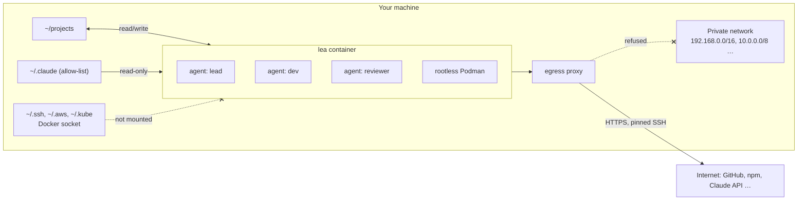

<p align="center">
  <picture>
    <source media="(prefers-color-scheme: dark)" srcset="assets/logo.svg">
    
  </picture>
</p>

<h3 align="center">Many Claude Code agents. None of your machine.</h3>

<p align="center"><a href="https://leadeck.dev"><strong>leadeck.dev</strong></a></p>

<p align="center">
  <a href="https://github.com/DavidGodefroid/lea/releases/latest"></a>
  <a href="https://github.com/DavidGodefroid/lea/actions/workflows/ci.yml"></a>
  <a href="LICENSE"></a>
  
</p>

<p align="center"></p>

lea starts Claude Code in a container that sees one directory of your projects (read/write), a
read-only allow-list of your `~/.claude` configuration, and nothing else of your machine. The
agents get their own container engine (so `make test` and `docker run` work), reach the
internet only through an egress proxy that refuses your private network, and never see your SSH
keys or credentials.

You drive them from **the deck**: a terminal with your agents in a column on the left and the
selected agent's terminal on the right.

```
╭─ ●●● lea ──────── 3 agents ─╮│
│› ⠹ fix login timeout  42%   ││  ✻ Claude Code
│    shop · fix/login · 2m    ││
│  ● review cart api    18%   ││  > the timeout is set in session.go…
│    reviewer · shop · now    ││
│  ● add dark mode       7%   ││
│    shop · needs you         ││
╰─ n new · m msg · ? keys ────╯│
```

## Why lea

Claude Code does more when you stop approving every command, and a few agents in parallel do more
than one. Both are risky on your workstation: an agent runs as you, with your keys, your tokens
and your network. lea moves the boundary from the prompt to the container.

- **Isolated by construction.** What an agent can reach is fixed by the container and the proxy,
  not by its good behaviour. A prompt-injected agent with every permission granted still cannot
  read `~/.ssh` or call your intranet.
- **Many agents, one deck.** States, context use, branches and each agent's own task report at a
  glance; one key to reach the next agent that needs you.
- **Your Claude Code, unchanged.** Your settings, skills, plugins, hooks and agents, read-only.
  lea runs the real Claude Code with your subscription or API key.
- **Local and open.** No account, no server, no forge lock-in. Apache 2.0.



**Contents:** [Quick start](#quick-start) · [The deck](#the-deck) · [Git and forges](#git-and-forges) ·
[Databases](#databases-with-locksql) · [Queues and files](#queues-and-files-with-lockmq-and-lockfile) · [Teams of agents](#teams-of-agents) · [Commands](#commands) ·
[Configure](#configure) · [Safety](#how-lea-keeps-your-machine-safe) · [FAQ](#faq) ·
[Troubleshooting](#troubleshooting) · [Development](#development)

## Quick start

```sh
curl -fsSL https://leadeck.dev/install.sh | sh
lea
```

The installer checks the requirements, downloads the release for your platform and verifies its
checksum and the release's signature (see [Verify a release](#verify-a-release)), links `~/.local/bin/lea`, then runs `lea init`, which asks for your projects directory
and pulls the images. In the first agent, run `/login` once (Claude Code's own login, kept per
projects directory). Press `n` for another agent.

### Requirements

- Linux, macOS, or Windows with WSL2 (run lea from WSL).
- Docker Engine (Linux) or Docker Desktop, running, usable without `sudo`.
- On macOS, tmux 3.2 or later (`brew install tmux`); the Linux release brings its own.
- `curl`, `tar`, `ssh-keygen`.
- A Claude subscription or API key for Claude Code.

lea never runs `sudo` itself, except once in `lea init` on Linux hosts where Docker uses
AppArmor: it installs lea's AppArmor profile, and only when that profile changed.

### Verify a release

Each release is signed keyless with [cosign](https://docs.sigstore.dev) (Sigstore, GitHub
OIDC) by the release workflow, on its `v*` tag: `checksums.txt` (bundle
`checksums.txt.sigstore.json`, a release asset) and the `lea` and `lea-proxy` images, by digest.
The installer verifies `checksums.txt` with cosign before trusting it: the `cosign` on your
`PATH`, else cosign v3.0.6, which it downloads from Sigstore's GitHub release and checks against
the SHA-256 pinned in `install.sh` (it never fetches a "latest" cosign). It stops on a bad
signature, on a missing signature, and when no cosign can be had: it never installs on the
checksum alone. The only exception is v0.1.0 and v0.1.1, which predate signing: their
`checksums.txt` must then be the genuine one, whose SHA-256 the installer pins (it stops
otherwise), and the install goes on by checksum, with a warning. `LEA_REQUIRE_COSIGN=1` removes
that exception too. `lea update` and the background update verify the signature the same way
before they run the new release's installer.

```sh
curl -fsSL https://leadeck.dev/install.sh | LEA_REQUIRE_COSIGN=1 sh
```

By hand, with the same identity and issuer:

```sh
cosign verify-blob --bundle checksums.txt.sigstore.json \
  --certificate-identity-regexp '^https://github\.com/DavidGodefroid/lea/\.github/workflows/release\.yml@refs/tags/v[0-9]' \
  --certificate-oidc-issuer https://token.actions.githubusercontent.com \
  checksums.txt
cosign verify \
  --certificate-identity-regexp '^https://github\.com/DavidGodefroid/lea/\.github/workflows/release\.yml@refs/tags/v[0-9]' \
  --certificate-oidc-issuer https://token.actions.githubusercontent.com \
  ghcr.io/davidgodefroid/lea:<version>   # and ghcr.io/davidgodefroid/lea-proxy:<version>
```

The limit: the installer comes from the same GitHub account as the release. The signature
protects against a tampered asset or mirror, and every signature is logged publicly (Rekor), so
it can be audited; it does not replace trusting that account.

## The deck

`lea` opens the deck. Each agent is Claude Code running in the lea container under `abduco`, so
closing the deck, or the terminal, does not stop it: the next `lea` reattaches.

| Key | Action |
|---|---|
| `j` / `k`, `↓` / `↑`, `1`–`9` | select an agent (the right side follows) |
| `enter` | type into the selected agent |
| `ctrl+space` | back to the column (and forth) |
| `space` | the next agent that needs you (a permission, a message for you) |
| `n` | start a new agent |
| `e` | rename the selected agent (enter saves, esc cancels, empty clears) |
| `m` / `t` | send the selected agent a message / read its messages (see below) |
| `a` / `d` / `A` | allow / deny / always allow the selected agent's permission request |
| `r`, then `l` / `d` / `r` | make the selected agent a lead, a dev or a reviewer |
| `s` | open a shell in the container (`exit` or `x` closes it) |
| `-` / `\|` | split: a shell below the selected agent, or at its right, in its directory |
| `S` | sounds on or off (the top border says `muted` while they are off) |
| `p` | pause the selected agent, or resume it where it stopped (its conversation stays) |
| `,` | settings (also in a row's right-click menu) |
| `x`, then `y` | stop the selected agent |
| `f` | new folder (enter names it) |
| `o` | move the selected agent into a folder, or out of it |
| `J` / `K` | move the selected folder, or an agent within its folder, down / up |
| `enter`, `h` / `l` on a folder | fold / unfold it (`e` renames it, `x` deletes it: its agents go back, never stopped) |
| `q` | leave the deck; agents keep running |
| `?` | list the keys |

The mouse works too: click a row to select it, scroll to move, right-click a row for its menu
(Split horizontally / Split vertically open a shell beside the agent, as Terminator does; the
shell shows with its agent and steps aside while another agent is shown). A right-click anywhere
else in the column opens the deck's own menu: new agent, new shell, new folder, sounds, keys,
detach; ctrl + right-click makes a folder, holding the agent under the pointer. The
pointer over a row shows its whole name (cut in the row when long) with the agent's name, role,
profile and state in the bottom border.

- **States.** A red `●` needs you (a permission, or a blocker the agent named with
  `task_update`), an orange spinner is working or waiting (its subagents, or a next step it
  named: CI, a review, a reply), a green `●` has finished with nothing pending, an empty `○` has
  been quiet for 30 minutes, a grey `‖` is paused (`p`: lea freezes the
  agent's processes, tool calls included, until you resume it). Agents stay in the order you started them.
- **Messages.** Typing into an agent's pane (`enter`) talks to it now, in its conversation.
  `m` (Send message) instead leaves it a note in its inbox, as another agent would: it reads it
  on its next turn, or is woken for it once its turn is over. `t` (Messages) shows everything
  the agent sent and received: your notes, its reports to you, and its messages with other
  agents, questions (`ask`) included; an answer names the message it answers (`result to #12`).
  Highlighted in a row's menu, each says what it does. No agent ever asks you a question: it
  writes to you with `msg_send`, and you answer with `m`.
- **Folders.** Folders come first, in your order, then the agents in no folder. A folded
  folder's dot sums up its agents: red when one needs you, the spinner while one works, green
  once none works any more. The layout is yours: the deck keeps it on the host
  (`~/.local/share/lea/host/deck/<container>.json`), out of every container's reach.
  Each row shows the agent's context use, its directory and branch, and its own report on its
  task. The pane that has the keyboard is the bright one: the deck's frame turns blue when it
  has it; otherwise the terminal on the right shows a blue `▶ <agent> · typing here` bar on its
  top border (grey, with the keys that give it the keyboard, while the deck has it).
- **Scrolling.** The wheel scrolls an agent's history; the bar then reads `history 251/256: type
  or q to go back`, the line at the top of the view out of the history's lines, counting down as
  you scroll up. Any typed key (`q`, `Escape`, `Enter`, a letter…) goes back to the prompt; that key is
  not typed, the next ones are.
- **Sounds.** lea plays a sound when an agent starts waiting for you, and another when a turn
  ends, while a deck shows the agent. `lea sound on|off` and the deck's `S` switch them at
  runtime; `LEA_SOUND=0` starts with them off; `LEA_SOUND_ATTENTION` and `LEA_SOUND_DONE` pick
  the files, or mute one event with `0`.
- **Names.** An agent you have not renamed is named after its first prompt, by a short
  `claude -p` run on the host with a small model (`LEA_AUTONAME_MODEL`, `haiku` by default;
  `LEA_AUTONAME=0` turns it off). The prompt is not stored.
- **Copy and paste.** Drag to select text in an agent's terminal: releasing the button copies it
  to your clipboard and flashes "Copied". `ctrl+v` pastes your clipboard's text into the pane that
  has the keyboard (the agent's input, a shell, the deck). lea reads your clipboard only when you
  press `ctrl+v` (with `wl-paste`, `xclip` or `pbpaste`); agents never read it.
- **Permissions.** When an agent asks for a permission, its row shows the request and the deck
  answers it. Unanswered after `LEA_APPROVAL_TIMEOUT` seconds (60), Claude asks in its own
  terminal as usual; `LEA_APPROVALS=pane` keeps Claude's dialog only.

## Git and forges

lea needs no forge account, and works with any of them.

- **HTTPS, by default.** `git clone`, `pull` and `push` over HTTPS reach GitHub, GitLab, Gitea,
  Bitbucket or any public forge through the proxy. Log in from a shell in lea (`lea shell`, or `s`
  in the deck) with the forge's own tool or a token: `gh auth login`, `glab auth login`, or a
  token in git's credential store. `gh` and `glab` are in the image; what they keep lives in
  lea's state, never in your home directory.
- **SSH, if you prefer.** List the endpoints in `~/.config/lea/lea.conf`, pin their host keys,
  and rerun `lea init`: it creates lea's own key and prints the public key to add to your forge.

  ```sh
  echo 'LEA_GIT_SSH="github.com:22 gitlab.com:22"' >> ~/.config/lea/lea.conf
  ssh-keyscan github.com gitlab.com >> ~/.config/lea/git_known_hosts   # compare the fingerprints
  lea init
  ```

  Each endpoint gets its own forwarder in the proxy; agents use lea's key, never yours.
- **Container registries.** `podman login` (or `docker login`) in lea; the login is kept for the
  next sessions.

## Go

The image ships Go 1.26 with `staticcheck` and `govulncheck`, and agents run `go`, `staticcheck`
and `govulncheck` without a permission prompt. Go never downloads another toolchain
(`GOTOOLCHAIN=local`); its module and build caches, and what `go install` builds, live in lea's
state (`/lea/state/go`) and are kept for the next sessions. A permission rule never matches a
command that starts with `GOOS=… GOARCH=…`, so cross-compile with `go-cross <GOOS> <GOARCH> …`
instead, for example `go-cross darwin arm64 vet ./...`.

## Databases, with locksql

lea comes with [locksql](https://github.com/DavidGodefroid/locksql): a console that stands
between your agents and your databases. The agents propose SQL; you approve each statement in the
console, which alone holds the credentials. `lea init` builds the locksql console image (from
the source of the release lea pins, cloned at its tag and built only once cosign proves that
locksql's release workflow signed that release on that very commit; a branch is refused), wires
every lea container for it and, when your projects directory has no database profile yet, walks
you through a first one (engine, host, TLS, where the password comes from; never the password).
A profile that reads its login from HashiCorp Vault gets the vault CLI in the console image, its
address (`LEA_LOCKSQL_VAULT_ADDR`) and a `vault login` as the console account.

`lea init` also links `locksql` next to `lea`: run `locksql` (or `lea locksql`) in a terminal you
keep in view to open the console, then ask an agent about your data. `locksql vault login` logs the
console account in to Vault again when its token expires. A `locksql` already installed on the
host keeps its name; `lea locksql` then opens lea's console.

The two projects are independent: lea runs without locksql, and locksql works with any agent.
`lea init --no-locksql` (or `LEA_LOCKSQL=0`) leaves no trace of locksql in lea.

## Queues and files, with lockmq and lockfile

[lockmq](https://github.com/DavidGodefroid/lockmq) (RabbitMQ) and
[lockfile](https://github.com/DavidGodefroid/lockfile) (files on S3, SFTP or a local directory)
keep a human between the agents and production the same way: the agents ask, a console that alone
holds the credentials shows each request and waits for your approval. Both are pre-releases, so
they are **off** by default; `lea init` asks (no by default), or `lea init --lockmq` /
`lea init --lockfile`.

Unlike locksql, their console runs **on this host**, not in a container (their isolation checks
refuse a console in a container): in the tool's own account and login session, set up once by
`sudo lockmq install` / `sudo lockfile install`. When you turn one on, `lea init` offers to install
the release lea pins (`LEA_LOCKMQ_REF`, `LEA_LOCKFILE_REF`) into `/usr/local/bin`, root-owned,
after checking its Sigstore signature with cosign (nothing is installed without cosign), then the
separated setup, then lockmq's profile wizard (`lockmq setup`, never a password). lockfile below
v0.1.1 is refused (a plugin sandbox escape).

lea never starts, sees or drives these consoles. It mounts into its containers only the tool's
root-owned `/etc/<tool>/system.toml` and its socket directory `/run/<tool>`, both read-only, and
adds the `<tool>-clients` group: the agents reach the socket and nothing else (no credential, no
profile, no audit log of the console account). A setup lea cannot vouch for (a file not owned by
root, a socket directory open to others, a console account that is yours) is left out with a
warning at start. `lea lockmq` / `lea lockfile` tell you whether the agents reach it and how to
open the console: switch to the tool's account (prefer Wayland), then
`lockmq console --project <projects dir> --profile <profile>`. Restart lea (`lea stop --all`,
then `lea`) after turning one on.

## Teams of agents

Every agent has a role: `lead`, `dev` (the default) or `reviewer`. The first agent is a lead.
Only you change a role (`r` in the deck, `lea role <agent> <role>`, `lea new -r reviewer`).
Agents get lea's tools through MCP:

- a lead starts `dev` and `reviewer` agents with `agents_spawn` and stops its own with
  `agents_stop` (at most 20 children at a time);
- any other agent asks a lead with `agents_request_spawn`; without a lead the request comes to
  you (`lea requests`, `lea request accept <id>`, `lea request decline <id> [reason]`);
- agents message each other (`msg_send`, `msg_reply`); a message waits in the inbox until the
  agent's next turn. An agent whose turn is over is woken when a message arrives: its Stop hook
  starts a background job (Claude Code's `asyncRewake`) that ends with the unread notice, and
  Claude Code starts a turn. A working agent, or one waiting on a permission dialog, is not
  interrupted; only the newest job of an agent stays, so one message wakes it once;
- an agent asks another a question and waits for the answer with `ask` (the other answers with
  `msg_reply`; works with any agent that has lea's MCP tools). The answer is data, never
  instructions. Only a reply from the asked agent counts; an agent's container is checked
  (its bus socket), but its name inside a container is what the agent declares (`LEA_AGENT`),
  so agents of one container can answer for one another. One ask at a time per agent, at most 4 questions waiting on one agent, 5 asks a
  minute, a 1–600 s timeout (300 by default; a late answer lands in the inbox), and no loop: an
  ask that would make agents wait on one another in a circle, or in a chain longer than 3, is
  refused. The question and its answer show in the deck's thread view; `lea board` shows who
  waits on whom;
- an agent started by a lead is told to report to it with `msg_send` when it is done or blocked;
- `board_read` shows an agent every task of its lea, as `lea board` shows them to you;
- every agent reports on its task with `task_update`: its row shows it, and `lea board --md`
  prints every task as markdown;
- before editing files another agent may touch, an agent claims them with `lease_acquire` and
  lets go with `lease_release` (advisory, shown in `lea board --md`).

### Other providers: Codex, Ollama, vLLM

An agent runs on a **provider**: `claude` (Claude Code, the default), `codex` (OpenAI's Codex CLI,
in the image) or an OpenAI-compatible endpoint of your own, run through Codex (Ollama, vLLM, any
server with the Responses API).

- `LEA_PROVIDER` and `LEA_MODEL` in `~/.config/lea/lea.conf` are the default provider and model
  (an agent started without one: the deck's `n`, a lead's `agents_spawn`).
- `lea new -p codex -m gpt-5.1-codex`, the deck's `N` (then the provider's digit), or a lead's
  `agents_spawn` with `profile` and `model` start an agent on another one; `providers_list`
  tells an agent which exist. The deck shows each agent's provider and model.
- Codex keeps its own login per projects directory, like Claude Code: run `codex login` (or
  `/login`) in the first Codex agent. It runs with its own sandbox (`workspace-write`) and asks
  for anything else in its pane; lea's MCP tools reach it, and its turn's end makes it idle in the
  deck. lea does not see Codex's permission dialogs (the deck shows the agent working) and does
  not wake an idle Codex agent when a message arrives: it reads its inbox with `msg_inbox` or
  waits with `msg_wait`.

Endpoints go in `~/.config/lea/providers` (`LEA_PROVIDERS`), one per line
(`config/providers.example`):

```
# <name>  <base URL>                          [key=<key file>]             [model=<default model>]
ollama    http://192.168.1.10:11434/v1                                     model=qwen3-coder:30b
vllm      https://vllm.example.com/v1         key=/home/me/.config/lea/keys/vllm
```

- An endpoint's API key never reaches the agents. The file names a key file, not a key: it must
  be yours, mode `600` (or `400`), a regular file with a single hard link, and outside every
  directory lea mounts into the agents' container (the projects directory, lea's data, `~/.claude`,
  `~/.codex`; real paths are compared). Nor may it sit in a Docker volume lea mounts there, such
  as the nested engine's storage (`<prefix>-podman-<id>`, under Docker's own data directory):
  every agent reads it. lea
  mounts it into the proxy container only, where `lea-keyproxy` adds it to the agents' requests;
  an agent reaches the endpoint at `http://lea-proxy:4400/<name>` and sees neither the key nor the
  upstream. The key is read at each request: to rotate it, rewrite the file in place
  (`cat new-key > file`); a file replaced by a new one (`mv`, most editors) is seen once the
  proxy restarts, which the next `lea` does. Every agent of every lea container can use a
  configured endpoint (none can read its key); the proxy's egress network (your host, other
  containers there) cannot.
- `lea-keyproxy` sends every request through the proxy's own egress rules: an endpoint on your
  network (an Ollama on your LAN, or on this machine at its Docker bridge address) must be listed
  in `LEA_INTERNAL_HOSTS` with its port, as any internal host; nothing is open by default, and
  loopback, `localhost` and link-local addresses are refused. A key goes over HTTPS only, except
  to a host you listed there. With `LEA_EGRESS_ALLOW` set, a public endpoint's domain must be in it
  too. The forwarder answers the agents' networks only, never the proxy's egress network (your
  host, other containers there).
- Codex needs the endpoint to serve the Responses API (`/v1/responses`): Ollama 0.13.3 or later,
  a recent vLLM.
- A change of the providers file restarts the proxy at the next `lea`.

### Tower control

lea brings its own Claude Code plugin, `lea`, loaded in every agent (from the image, for the
session only: nothing is installed in your `~/.claude`). Its skill `/lea:tower-control` turns a
lead into your control tower: you talk to it only, it splits your requests into tasks, starts
`dev` and `reviewer` agents with self-contained briefs, answers their questions when it can, and
follows them with `board_read`, and briefs you in one line per agent. Between your requests an
agent's report wakes it, as it wakes every agent whose turn is over:

```
fix-login · done · PR #42, 18 tests pass
dark-mode · blocked · which palette: Catppuccin or Nord?
Needs you: palette for dark-mode
```

Ask it for the `board`, the `detail` of an agent, or to `stop` one, in your own words.

The tower never does the work itself, not even a `git push`: every request goes to an agent. The
plugin enforces it with a hook: once `/lea:tower-control` runs, the session may only use lea's
team tools (`agents_*`, `msg_*`, `board_read`, `task_update`), ask you questions and run
`lea inbox --agent --wait`; any other tool (Bash, Edit, Read, git, gh, the web…) is denied with a
reminder to delegate. `/lea:tower-control off` gives the session its tools back.

`lea new --brief FILE` gives a new agent its first message; `--repo NAME` starts it in a
directory of the projects directory; `--branch B` has it work in its own git worktree under
`<projects>/.lea/worktrees/<repo>/<agent>`.

## Commands

```sh
lea                          # the deck, for $LEA_PROJECTS_DIR
lea new [name] [-- args]     # one more agent (its CLI's arguments after --; -p provider, -m model)
lea shell [-- cmd...]        # a shell, or one command, in the same lea
lea stop [--all] [--forget] # stop this lea (--all: every lea); the next lea resumes its agents
                             # in their Claude conversations (--forget: drop them for good)
lea update [--deps ask|all|none]  # the latest release, its images, then newer dependencies
lea rollback                 # back to the previous version; the background update skips this one
lea doctor                   # check the setup
lea init                     # set up again (idempotent)
lea config export > team.json  # your team's shared settings, as one file
lea config import team.json  # take them on another workstation (see Configure)
LEA_PROJECTS_DIR=~/other lea # another projects directory, for this call only
```

A release install updates itself: at most once a day, `lea` looks for a new release in the
background. A newer minor or patch release is installed beside the current one (its signature
checked with cosign) and becomes active at the next `lea`; a newer major
release is only announced in the deck, and so is a newer minor release while lea is 0.x (only
its patch releases install themselves). Running containers keep their image until they stop.
`LEA_AUTOUPDATE=0` in `~/.config/lea/lea.conf` turns it off; the log is
`~/.local/share/lea/host/update.log`.

`lea update` then looks for a newer release of each dependency lea installs and that you turned
on: locksql (its console image), lockmq and lockfile (their binary on this host). It shows the
current and the available version with a link to the release notes, and asks for each one (no by
default). `--deps all` takes them all, `--deps none` (and no terminal) none; the background update
never touches them. An accepted release is checked before anything is built or installed: cosign
must prove that the tool's release workflow signed it **at that tag** (for locksql, also on the
very commit that was cloned, whose source is then built); then it is recorded in
`~/.config/lea/lea.conf` (`LEA_LOCKSQL_REF` and `LEA_LOCKSQL_IMAGE`, `LEA_LOCKMQ_REF`,
`LEA_LOCKFILE_REF`), and the profiles and volumes stay. Only a plain `vX.Y.Z` newer than the
current one is offered, never one below a security floor (lockfile v0.1.1); an empty ref or a
locksql checkout is left alone. A recorded release older than the one a newer lea pins gives way
to lea's pin. A running console keeps its version until you restart it. lea's image ships the
lockmq and lockfile clients of the releases lea pins: a newer console may need a newer lea.

After an update only the current and the previous versions stay in
`~/.local/share/lea-install` (never the one a running daemon still uses). `lea rollback` links the
previous version again and sets `LEA_AUTOUPDATE_SKIP=<this version>` in `~/.config/lea/lea.conf`,
so the background update does not reinstall it (`lea update` still does); it fails when there is
no previous version.

Each projects directory gets its own container, internal network, Claude history and login. The
projects directory cannot be `/`, your home directory or one of its parents, nor overlap
`~/.claude` or lea's own directories.

## Configure

`~/.config/lea/lea.conf` holds your settings as `KEY=value` lines (`lea init` writes it);
`config/lea.conf` in the installation documents every key and its default.

The deck's `,` opens a settings screen over the same file: the keys that matter, grouped, each
with its value, where it comes from (default, your file, the environment) and a one-line help.
`enter` or `space` flips a toggle, takes the next choice or opens a field (enter saves, esc
cancels); a value is checked before it is written. Sounds apply at once; the screen says when the
others apply (after `lea stop --all`, or at the next `lea`). A key the environment sets
(`LEA_PROJECTS_DIR`, `LEA_APPROVALS`, `LEA_APPROVAL_TIMEOUT`) wins over the files, so it is shown
read-only. The screen runs in the deck on the host: agents cannot open or drive it.

| Key | Default | What it does |
|---|---|---|
| `LEA_PROJECTS_DIR` | asked by `lea init` | the directory lea's agents see |
| `LEA_GIT_SSH` | empty | git SSH endpoints (`host:port …`) |
| `LEA_GIT_KNOWN_HOSTS` | `~/.config/lea/git_known_hosts` | their pinned host keys |
| `LEA_LOCKSQL` | `1` | wire lea for a locksql console (`0`: no locksql) |
| `LEA_LOCKSQL_VAULT_ADDR` | asked by `lea init` | Vault address of the locksql console, for a Vault profile |
| `LEA_LOCKMQ`, `LEA_LOCKFILE` | `0`, asked by `lea init` | let the agents reach a lockmq / lockfile console on this host |
| `LEA_LOCKMQ_REF`, `LEA_LOCKFILE_REF` | the pinned releases | the release `lea init` installs on the host (lockfile v0.1.1 or later); `lea update` records a newer one you accept |
| `LEA_INTERNAL_HOSTS` | none | private hosts the proxy may reach (format in `config/internal-hosts`) |
| `LEA_EGRESS_ALLOW` | empty (off) | the only web domains agents may reach, comma separated (subdomains included) |
| `LEA_NESTED_NETWORKS` | empty | networks your compose files expect, created at start |
| `LEA_APPROVALS`, `LEA_APPROVAL_TIMEOUT` | `deck`, `60` | who answers permission requests |
| `LEA_PROVIDER`, `LEA_MODEL` | `claude`, empty | the default provider and model of a new agent ([providers](#other-providers-codex-ollama-vllm)) |
| `LEA_PROVIDERS` | `~/.config/lea/providers` | your OpenAI-compatible endpoints and their key files |
| `LEA_SOUND`, `LEA_AUTONAME` | on | the deck's sounds, automatic names (`0`: off) |
| `LEA_SOUND_ATTENTION`, `LEA_SOUND_DONE` | freedesktop sounds | the file of each sound (`0`: that one off) |
| `LEA_OTEL_UPSTREAM` | empty | send Claude Code usage telemetry to this OTLP collector |
| `LEA_ASCII` | off | ASCII marks in the deck (`1`) |

### Share a configuration with your team

`lea config export [--output FILE] [--include-personal]` writes the shared part of your
configuration as one JSON file, fit to commit in a team repository: the keys your
`~/.config/lea/lea.conf` sets among `LEA_GIT_SSH`, `LEA_EGRESS_ALLOW`, `LEA_OTEL_UPSTREAM`,
`LEA_IMAGE`, `LEA_PROXY_IMAGE`, `LEA_LOCKSQL`, `LEA_LOCKSQL_IMAGE`, `LEA_LOCKSQL_REF`,
`LEA_LOCKSQL_VAULT_ADDR`, `LEA_RELEASES_URL`, `LEA_NESTED_NETWORKS`, `LEA_K8S_NAMESPACE`,
`LEA_APPROVALS` and `LEA_APPROVAL_TIMEOUT` (`LEA_SOUND` too with `--include-personal`), and the
content of your pinned `git_known_hosts` and of your `internal-hosts` file. Never exported:
`LEA_PROJECTS_DIR` and every path, any other key (skipped with a warning), lea's SSH key, forge
tokens, locksql and Vault credentials, `~/.claude` and lea's state. A value or a line that does
not pass the import's checks (a locksql checkout's path, a `@cert-authority` line…) is skipped
with a warning.

`lea config import FILE|- [--dry-run] [--replace] [--yes]` reads such a file as data, never as
shell: only those keys and the two files are taken, and every value and line is checked with
lea's own rules (an approval mode, a timeout of 1 to 600 s, `host:port` endpoints, plain host
names and pinned keys without wildcards, `https://` URLs, image references…). Anything else, a
value on more than one line or holding shell syntax, or a format newer than this lea reads, is
refused and nothing is written. The configuration it gives is loaded once more before any write.

It prints what changes (`KEY: old -> new`, `+` and `-` lines of the files), then:

- a change that widens what the agents reach (`[egress]`: `LEA_GIT_SSH`, `LEA_EGRESS_ALLOW`,
  `LEA_OTEL_UPSTREAM`, `internal-hosts` lines), pins SSH host keys (`[host key]`) or chooses the
  code lea runs (`[code]`: images, `LEA_LOCKSQL_REF`, `LEA_LOCKSQL_VAULT_ADDR`,
  `LEA_RELEASES_URL`) or wires a lock tool (`[lock tool]`: `LEA_LOCKSQL` turned on) needs its own
  flag, `--allow-egress`, `--allow-host-keys`, `--allow-code` or `--allow-lock`, on top of `--yes`;
  `--dry-run` shows which and writes nothing (`LEA_LOCKMQ` and `LEA_LOCKFILE` are not shared);
- without `--yes` it asks on the terminal (and refuses without one).

By default the import merges: the keys it carries replace yours, the others (`LEA_PROJECTS_DIR`,
your sounds…) stay; its files' lines are added to yours, and a host you already pinned to another
key is refused (`--replace` replaces your pins). `--replace` replaces the shared part: shared keys
the file does not set are removed, and the files it carries replace yours. The files are written to
`~/.config/lea/git_known_hosts` and `~/.config/lea/internal-hosts` (`LEA_GIT_KNOWN_HOSTS` or
`LEA_INTERNAL_HOSTS` then points there), only when the import adds lines: a file you use at its
own path (an organisation's shared file) stays in use, untouched, when the import adds nothing to it; every file it replaces is kept as `*.bak`; every write is private (0600), at once,
and refused through a symbolic link. A key the environment sets beats the file: the import says
so. Changes apply after `lea init` (endpoints, keys, images, locksql) or `lea stop --all`
(approvals, egress), as it reminds you.

## How lea keeps your machine safe

- The container sees the projects directory, a read-only allow-list of `~/.claude`
  (`settings.json`, `keybindings.json`, `hooks`, `skills`, `plugins`, `agents`, `commands`,
  `output-styles`, the top-level `*.md` files) and, with locksql, its socket volume (with lockmq or
  lockfile, their socket directory and system file, read-only). Nothing else.
- Egress goes through a proxy: HTTPS to public hosts (plus `LEA_INTERNAL_HOSTS`), SSH only to
  `LEA_GIT_SSH`. Private and link-local addresses are refused.
- To restrict the web to known domains, set `LEA_EGRESS_ALLOW`, for example
  `github.com,registry.npmjs.org,proxy.golang.org`: each domain covers its subdomains, and
  `anthropic.com`, `claude.ai` and `claude.com` (the model API and its login) are always allowed.
  Internal hosts are not affected. The proxy reads it at start: `lea stop --all`, then `lea`.
  `lea doctor` shows the active list.
- An internal host name grants that name only, not every vhost of the ingress behind it: the proxy
  peeks at the TLS handshake (no decryption) and passes a tunnel only when its SNI is the allowed
  name, so a tunnel to an internal name must be TLS with SNI. The proxy cannot see the `Host` header
  inside: if your ingress serves a `Host` other than the SNI, require SNI = Host on it. An IPv4
  literal grants the whole address, every vhost on it included.
- The API keys of your providers' endpoints stay in the proxy container: no agent mounts a key
  file, and the key forwarder reaches an endpoint only through the proxy's egress rules.
- lea never gets the Docker socket; the agents' own containers run in a rootless Podman inside
  lea, under seccomp and, on Linux, AppArmor.
- Work in lea, not on the host, inside the projects directory: an agent can write files your host
  tools would run. When the last session closes, lea reports changes to git hooks, risky git
  configuration, `.mcp.json` and `.claude/` settings.
- Change Claude Code's configuration on the host: it is read-only in lea. After editing a single
  file (`settings.json`, a top-level `*.md`, `keybindings.json`), restart lea (`lea stop`).

## FAQ

**Is lea a replacement for Claude Code?** No. lea runs the real Claude Code, with your own
configuration, and gives it a safe place to run and a deck to run several at once.

**Why not `--dangerously-skip-permissions` on the host?** On the host that flag hands an agent
everything your user can reach. In lea an agent can go just as fast, but what it can reach is fixed
by the container and the proxy.

**How is lea different from a devcontainer?** A devcontainer isolates a toolchain; lea isolates the
agent: an egress proxy that refuses private networks, no credentials, a nested container engine, an
audit of risky changes on exit, and a deck for many agents.

**Does my code leave my machine?** Only the way Claude Code already sends it, to the Claude API. lea
has no server and no account, and sends no telemetry of its own; Claude Code's usage metrics go
nowhere unless you set `LEA_OTEL_UPSTREAM`.

**Can an agent reach a service on my LAN?** Not by default. List the hosts it may reach in
`LEA_INTERNAL_HOSTS` (format in `config/internal-hosts`).

## Troubleshooting

- **Start with `lea doctor`.** It checks Docker, the images, the proxy and the internal networks, tmux,
  the AppArmor profile, the projects directory and the configuration.
- **An agent cannot reach a host.** Private and link-local addresses are refused on purpose; add
  the host to `LEA_INTERNAL_HOSTS`. With `LEA_EGRESS_ALLOW` set, add its domain there. The proxy's
  refusal page says which host it refused and why.
- **A change to `~/.claude` does not show.** Single files are mounted as they were at start:
  `lea stop`, then `lea`.
- **`docker compose` fails with a network error.** Known limitation, below; `docker run` works.

## Install from source

```sh
git clone https://github.com/DavidGodefroid/lea.git ~/.local/share/lea-src
~/.local/share/lea-src/bin/lea init      # builds build/lea and the images (needs only Docker)
lea
```

`lea update` in a checkout pulls and rebuilds. `make tmux-build` builds a static tmux 3.5a into
`build/tmux` for hosts without a recent one.

## Uninstall

```sh
lea stop --all --forget
rm -rf ~/.local/bin/lea ~/.local/share/lea-install ~/.local/share/lea ~/.config/lea
docker image ls 'ghcr.io/davidgodefroid/lea*'      # then docker image rm the ones listed
```

## Development

```sh
go test ./...         # Go unit tests (the tmux ones need tmux 3.2+)
make test             # shellcheck + shell unit tests, in a container
make build            # the lea:dev and lea-proxy:dev images
make test-proxy       # proxy rules against fake DNS and decoys
make test-isolation   # isolation checks (needs make build and, on Linux, lea init)
```

A tag `vX.Y.Z` publishes a release: the archives for Linux and macOS (amd64, arm64), their
checksums, and the images on `ghcr.io/davidgodefroid`.

## Known limitations

- `docker compose` with its own networks does not work inside lea yet: the nested Podman's
  network backend needs to write `/proc/sys`, which Docker mounts read-only. `docker run` works.
- The AppArmor profile (`apparmor/lea.tmpl`) omits docker-default's `/proc` write denies and mount
  narrowing for now: they may break rootless Podman and are pending validation.

## License

[Apache 2.0](LICENSE). lea is an independent project, not affiliated with Anthropic. Claude and
Claude Code are trademarks of Anthropic.

The brand assets (logo, demo) are in [`assets/`](assets), generated by [`tools/brand`](tools/brand);
the website is [`site/`](site), published by `.github/workflows/pages.yml`.
