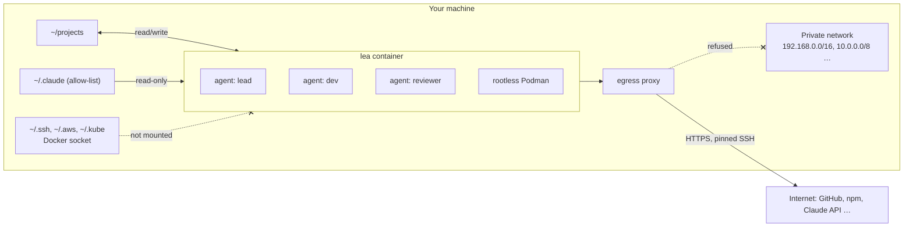

<p align="center">
  <picture>
    <source media="(prefers-color-scheme: dark)" srcset="assets/logo.svg">
    
  </picture>
</p>

<h3 align="center">Many Claude Code agents. None of your machine.</h3>

<p align="center"><a href="https://leadeck.dev"><strong>leadeck.dev</strong></a></p>

<p align="center">
  <a href="https://github.com/DavidGodefroid/lea/releases/latest"></a>
  <a href="https://github.com/DavidGodefroid/lea/actions/workflows/ci.yml"></a>
  <a href="LICENSE"></a>
  
</p>

<p align="center"></p>

lea starts Claude Code in a container that sees one directory of your projects (read/write), a
read-only allow-list of your `~/.claude` configuration, and nothing else of your machine. The
agents get their own container engine (so `make test` and `docker run` work), reach the
internet only through an egress proxy that refuses your private network, and never see your SSH
keys or credentials.

You drive them from **the deck**: a terminal with your agents in a column on the left and the
selected agent's terminal on the right.

```
╭─ ●●● lea ──────── 3 agents ─╮│
│› ⠹ fix login timeout  42%   ││  ✻ Claude Code
│    shop · fix/login · 2m    ││
│  ● review cart api    18%   ││  > the timeout is set in session.go…
│    reviewer · shop · now    ││
│  ● add dark mode       7%   ││
│    shop · needs you         ││
╰─ n new · m msg · ? keys ────╯│
```

## Why lea

Claude Code does more when you stop approving every command, and a few agents in parallel do more
than one. Both are risky on your workstation: an agent runs as you, with your keys, your tokens
and your network. lea moves the boundary from the prompt to the container.

- **Isolated by construction.** What an agent can reach is fixed by the container and the proxy,
  not by its good behaviour. A prompt-injected agent with every permission granted still cannot
  read `~/.ssh` or call your intranet.
- **Many agents, one deck.** States, context use, branches and each agent's own task report at a
  glance; one key to reach the next agent that needs you.
- **Your Claude Code, unchanged.** Your settings, skills, plugins, hooks and agents, read-only.
  lea runs the real Claude Code with your subscription or API key.
- **Local and open.** No account, no server, no forge lock-in. Apache 2.0.



**Contents:** [Quick start](#quick-start) · [The deck](#the-deck) · [Git and forges](#git-and-forges) ·
[Databases](#databases-with-locksql) · [Teams of agents](#teams-of-agents) · [Commands](#commands) ·
[Configure](#configure) · [Safety](#how-lea-keeps-your-machine-safe) · [FAQ](#faq) ·
[Troubleshooting](#troubleshooting) · [Development](#development)

## Quick start

```sh
curl -fsSL https://leadeck.dev/install.sh | sh
lea
```

The installer checks the requirements, downloads the release for your platform and verifies its
checksum (and, when `cosign` is installed, the release's signature: see
[Verify a release](#verify-a-release)), links `~/.local/bin/lea`, then runs `lea init`, which asks for your projects directory
and pulls the images. In the first agent, run `/login` once (Claude Code's own login, kept per
projects directory). Press `n` for another agent.

### Requirements

- Linux, macOS, or Windows with WSL2 (run lea from WSL).
- Docker Engine (Linux) or Docker Desktop, running, usable without `sudo`.
- On macOS, tmux 3.2 or later (`brew install tmux`); the Linux release brings its own.
- `curl`, `tar`, `ssh-keygen`.
- A Claude subscription or API key for Claude Code.

lea never runs `sudo` itself, except once in `lea init` on Linux hosts where Docker uses
AppArmor: it installs lea's AppArmor profile, and only when that profile changed.

### Verify a release

Each release is signed keyless with [cosign](https://docs.sigstore.dev) (Sigstore, GitHub
OIDC) by the release workflow, on its `v*` tag: `checksums.txt` (bundle
`checksums.txt.sigstore.json`, a release asset) and the `lea` and `lea-proxy` images, by digest.
With `cosign` installed, the installer verifies `checksums.txt` before trusting it. It stops on a
bad signature. It stops on a missing signature, except for v0.1.0 and v0.1.1, which predate
signing: their `checksums.txt` must then be the genuine one, whose SHA-256 the installer pins
(it stops otherwise), and the install goes on by checksum, with a warning. Without `cosign`, it warns and relies
on the checksum alone. `LEA_REQUIRE_COSIGN=1` makes the signature mandatory with no exception: it
refuses to install without `cosign` or without a signature:

```sh
curl -fsSL https://leadeck.dev/install.sh | LEA_REQUIRE_COSIGN=1 sh
```

By hand, with the same identity and issuer:

```sh
cosign verify-blob --bundle checksums.txt.sigstore.json \
  --certificate-identity-regexp '^https://github\.com/DavidGodefroid/lea/\.github/workflows/release\.yml@refs/tags/v[0-9]' \
  --certificate-oidc-issuer https://token.actions.githubusercontent.com \
  checksums.txt
cosign verify \
  --certificate-identity-regexp '^https://github\.com/DavidGodefroid/lea/\.github/workflows/release\.yml@refs/tags/v[0-9]' \
  --certificate-oidc-issuer https://token.actions.githubusercontent.com \
  ghcr.io/davidgodefroid/lea:<version>   # and ghcr.io/davidgodefroid/lea-proxy:<version>
```

The limit: the installer comes from the same GitHub account as the release. The signature
protects against a tampered asset or mirror, and every signature is logged publicly (Rekor), so
it can be audited; it does not replace trusting that account.

## The deck

`lea` opens the deck. Each agent is Claude Code running in the lea container under `abduco`, so
closing the deck, or the terminal, does not stop it: the next `lea` reattaches.

| Key | Action |
|---|---|
| `j` / `k`, `↓` / `↑`, `1`–`9` | select an agent (the right side follows) |
| `enter` | type into the selected agent |
| `ctrl+space` | back to the column (and forth) |
| `space` | the next agent that needs you (a permission, a message for you) |
| `n` | start a new agent |
| `e` | rename the selected agent (enter saves, esc cancels, empty clears) |
| `m` / `t` | write to the selected agent / read its messages |
| `a` / `d` / `A` | allow / deny / always allow the selected agent's permission request |
| `r`, then `l` / `d` / `r` | make the selected agent a lead, a dev or a reviewer |
| `s` | open a shell in the container (`exit` or `x` closes it) |
| `-` / `\|` | split: a shell below the selected agent, or at its right, in its directory |
| `S` | sounds on or off (the top border says `muted` while they are off) |
| `x`, then `y` | stop the selected agent |
| `q` | leave the deck; agents keep running |
| `?` | list the keys |

The mouse works too: click a row to select it, scroll to move, right-click a row for its menu
(Split horizontally / Split vertically open a shell beside the agent, as Terminator does; the
shell shows with its agent and steps aside while another agent is shown).

- **States.** A red `●` needs you, an orange spinner is working, a green `●` has finished its
  turn, an empty `○` has been quiet for 30 minutes. Agents stay in the order you started them.
  Each row shows the agent's context use, its directory and branch, and its own report on its
  task. The pane that has the keyboard is the bright one: the deck's frame turns blue when it
  has it; otherwise the terminal on the right shows a blue `▶ <agent> · typing here` bar on its
  top border (grey, with the keys that give it the keyboard, while the deck has it).
- **Scrolling.** The wheel scrolls an agent's history; the bar then reads `history 251/256: type
  or q to go back`, the line at the top of the view out of the history's lines, counting down as
  you scroll up. Any typed key (`q`, `Escape`, `Enter`, a letter…) goes back to the prompt; that key is
  not typed, the next ones are.
- **Sounds.** lea plays a sound when an agent starts waiting for you, and another when a turn
  ends, while a deck shows the agent. `lea sound on|off` and the deck's `S` switch them at
  runtime; `LEA_SOUND=0` starts with them off; `LEA_SOUND_ATTENTION` and `LEA_SOUND_DONE` pick
  the files, or mute one event with `0`.
- **Names.** An agent you have not renamed is named after its first prompt, by a short
  `claude -p` run on the host with a small model (`LEA_AUTONAME_MODEL`, `haiku` by default;
  `LEA_AUTONAME=0` turns it off). The prompt is not stored.
- **Copy and paste.** Drag to select text in an agent's terminal: releasing the button copies it
  to your clipboard and flashes "Copied". `ctrl+v` pastes your clipboard's text into the pane that
  has the keyboard (the agent's input, a shell, the deck). lea reads your clipboard only when you
  press `ctrl+v` (with `wl-paste`, `xclip` or `pbpaste`); agents never read it.
- **Permissions.** When an agent asks for a permission, its row shows the request and the deck
  answers it. Unanswered after `LEA_APPROVAL_TIMEOUT` seconds (60), Claude asks in its own
  terminal as usual; `LEA_APPROVALS=pane` keeps Claude's dialog only.

## Git and forges

lea needs no forge account, and works with any of them.

- **HTTPS, by default.** `git clone`, `pull` and `push` over HTTPS reach GitHub, GitLab, Gitea,
  Bitbucket or any public forge through the proxy. Log in from a shell in lea (`lea shell`, or `s`
  in the deck) with the forge's own tool or a token: `gh auth login`, `glab auth login`, or a
  token in git's credential store. `gh` and `glab` are in the image; what they keep lives in
  lea's state, never in your home directory.
- **SSH, if you prefer.** List the endpoints in `~/.config/lea/lea.conf`, pin their host keys,
  and rerun `lea init`: it creates lea's own key and prints the public key to add to your forge.

  ```sh
  echo 'LEA_GIT_SSH="github.com:22 gitlab.com:22"' >> ~/.config/lea/lea.conf
  ssh-keyscan github.com gitlab.com >> ~/.config/lea/git_known_hosts   # compare the fingerprints
  lea init
  ```

  Each endpoint gets its own forwarder in the proxy; agents use lea's key, never yours.
- **Container registries.** `podman login` (or `docker login`) in lea; the login is kept for the
  next sessions.

## Go

The image ships Go 1.26 with `staticcheck` and `govulncheck`, and agents run `go`, `staticcheck`
and `govulncheck` without a permission prompt. Go never downloads another toolchain
(`GOTOOLCHAIN=local`); its module and build caches, and what `go install` builds, live in lea's
state (`/lea/state/go`) and are kept for the next sessions. A permission rule never matches a
command that starts with `GOOS=… GOARCH=…`, so cross-compile with `go-cross <GOOS> <GOARCH> …`
instead, for example `go-cross darwin arm64 vet ./...`.

## Databases, with locksql

lea comes with [locksql](https://github.com/DavidGodefroid/locksql): a console that stands
between your agents and your databases. The agents propose SQL; you approve each statement in the
console, which alone holds the credentials. `lea init` builds the locksql console image, wires
every lea container for it and, when your projects directory has no database profile yet, walks
you through a first one (engine, host, TLS, where the password comes from; never the password).
A profile that reads its login from HashiCorp Vault gets the vault CLI in the console image, its
address (`LEA_LOCKSQL_VAULT_ADDR`) and a `vault login` as the console account.

`lea init` also links `locksql` next to `lea`: run `locksql` (or `lea locksql`) in a terminal you
keep in view to open the console, then ask an agent about your data. `locksql vault login` logs the
console account in to Vault again when its token expires. A `locksql` already installed on the
host keeps its name; `lea locksql` then opens lea's console.

The two projects are independent: lea runs without locksql, and locksql works with any agent.
`lea init --no-locksql` (or `LEA_LOCKSQL=0`) leaves no trace of locksql in lea.

## Teams of agents

Every agent has a role: `lead`, `dev` (the default) or `reviewer`. The first agent is a lead.
Only you change a role (`r` in the deck, `lea role <agent> <role>`, `lea new -r reviewer`).
Agents get lea's tools through MCP:

- a lead starts `dev` and `reviewer` agents with `agents_spawn` and stops its own with
  `agents_stop` (at most 20 children at a time);
- any other agent asks a lead with `agents_request_spawn`; without a lead the request comes to
  you (`lea requests`, `lea request accept <id>`, `lea request decline <id> [reason]`);
- agents message each other (`msg_send`, `msg_reply`); a message waits in the inbox until the
  agent's next turn. An agent whose turn is over is woken when a message arrives: its Stop hook
  starts a background job (Claude Code's `asyncRewake`) that ends with the unread notice, and
  Claude Code starts a turn. A working agent, or one waiting on a permission dialog, is not
  interrupted; only the newest job of an agent stays, so one message wakes it once;
- an agent started by a lead is told to report to it with `msg_send` when it is done or blocked;
- `board_read` shows an agent every task of its lea, as `lea board` shows them to you;
- every agent reports on its task with `task_update`: its row shows it, and `lea board --md`
  prints every task as markdown;
- before editing files another agent may touch, an agent claims them with `lease_acquire` and
  lets go with `lease_release` (advisory, shown in `lea board --md`).

### Tower control

lea brings its own Claude Code plugin, `lea`, loaded in every agent (from the image, for the
session only: nothing is installed in your `~/.claude`). Its skill `/lea:tower-control` turns a
lead into your control tower: you talk to it only, it splits your requests into tasks, starts
`dev` and `reviewer` agents with self-contained briefs, answers their questions when it can, and
follows them with `board_read`, and briefs you in one line per agent. Between your requests an
agent's report wakes it, as it wakes every agent whose turn is over:

```
fix-login · done · PR #42, 18 tests pass
dark-mode · blocked · which palette: Catppuccin or Nord?
Needs you: palette for dark-mode
```

Ask it for the `board`, the `detail` of an agent, or to `stop` one, in your own words.

The tower never does the work itself, not even a `git push`: every request goes to an agent. The
plugin enforces it with a hook: once `/lea:tower-control` runs, the session may only use lea's
team tools (`agents_*`, `msg_*`, `board_read`, `task_update`), ask you questions and run
`lea inbox --agent --wait`; any other tool (Bash, Edit, Read, git, gh, the web…) is denied with a
reminder to delegate. `/lea:tower-control off` gives the session its tools back.

`lea new --brief FILE` gives a new agent its first message; `--repo NAME` starts it in a
directory of the projects directory; `--branch B` has it work in its own git worktree under
`<projects>/.lea/worktrees/<repo>/<agent>`.

## Commands

```sh
lea                          # the deck, for $LEA_PROJECTS_DIR
lea new [name] [-- args]     # one more agent (Claude Code arguments after --)
lea shell [-- cmd...]        # a shell, or one command, in the same lea
lea stop [--all]             # stop this lea and its agents (--all: every lea)
lea update                   # the latest release, and its images
lea doctor                   # check the setup
lea init                     # set up again (idempotent)
LEA_PROJECTS_DIR=~/other lea # another projects directory, for this call only
```

Each projects directory gets its own container, internal network, Claude history and login. The
projects directory cannot be `/`, your home directory or one of its parents, nor overlap
`~/.claude` or lea's own directories.

## Configure

`~/.config/lea/lea.conf` holds your settings as `KEY=value` lines (`lea init` writes it);
`config/lea.conf` in the installation documents every key and its default.

| Key | Default | What it does |
|---|---|---|
| `LEA_PROJECTS_DIR` | asked by `lea init` | the directory lea's agents see |
| `LEA_GIT_SSH` | empty | git SSH endpoints (`host:port …`) |
| `LEA_GIT_KNOWN_HOSTS` | `~/.config/lea/git_known_hosts` | their pinned host keys |
| `LEA_LOCKSQL` | `1` | wire lea for a locksql console (`0`: no locksql) |
| `LEA_LOCKSQL_VAULT_ADDR` | asked by `lea init` | Vault address of the locksql console, for a Vault profile |
| `LEA_INTERNAL_HOSTS` | none | private hosts the proxy may reach (format in `config/internal-hosts`) |
| `LEA_NESTED_NETWORKS` | empty | networks your compose files expect, created at start |
| `LEA_APPROVALS`, `LEA_APPROVAL_TIMEOUT` | `deck`, `60` | who answers permission requests |
| `LEA_SOUND`, `LEA_AUTONAME` | on | the deck's sounds, automatic names (`0`: off) |
| `LEA_SOUND_ATTENTION`, `LEA_SOUND_DONE` | freedesktop sounds | the file of each sound (`0`: that one off) |
| `LEA_OTEL_UPSTREAM` | empty | send Claude Code usage telemetry to this OTLP collector |
| `LEA_ASCII` | off | ASCII marks in the deck (`1`) |

## How lea keeps your machine safe

- The container sees the projects directory, a read-only allow-list of `~/.claude`
  (`settings.json`, `keybindings.json`, `hooks`, `skills`, `plugins`, `agents`, `commands`,
  `output-styles`, the top-level `*.md` files) and, with locksql, its socket volume. Nothing else.
- Egress goes through a proxy: HTTPS to public hosts (plus `LEA_INTERNAL_HOSTS`), SSH only to
  `LEA_GIT_SSH`. Private and link-local addresses are refused.
- lea never gets the Docker socket; the agents' own containers run in a rootless Podman inside
  lea, under seccomp and, on Linux, AppArmor.
- Work in lea, not on the host, inside the projects directory: an agent can write files your host
  tools would run. When the last session closes, lea reports changes to git hooks, risky git
  configuration, `.mcp.json` and `.claude/` settings.
- Change Claude Code's configuration on the host: it is read-only in lea. After editing a single
  file (`settings.json`, a top-level `*.md`, `keybindings.json`), restart lea (`lea stop`).

## FAQ

**Is lea a replacement for Claude Code?** No. lea runs the real Claude Code, with your own
configuration, and gives it a safe place to run and a deck to run several at once.

**Why not `--dangerously-skip-permissions` on the host?** On the host that flag hands an agent
everything your user can reach. In lea an agent can go just as fast, but what it can reach is fixed
by the container and the proxy.

**How is lea different from a devcontainer?** A devcontainer isolates a toolchain; lea isolates the
agent: an egress proxy that refuses private networks, no credentials, a nested container engine, an
audit of risky changes on exit, and a deck for many agents.

**Does my code leave my machine?** Only the way Claude Code already sends it, to the Claude API. lea
has no server and no account, and sends no telemetry of its own; Claude Code's usage metrics go
nowhere unless you set `LEA_OTEL_UPSTREAM`.

**Can an agent reach a service on my LAN?** Not by default. List the hosts it may reach in
`LEA_INTERNAL_HOSTS` (format in `config/internal-hosts`).

## Troubleshooting

- **Start with `lea doctor`.** It checks Docker, the images, the proxy and the internal networks, tmux,
  the AppArmor profile, the projects directory and the configuration.
- **An agent cannot reach a host.** Private and link-local addresses are refused on purpose; add
  the host to `LEA_INTERNAL_HOSTS`. The proxy's refusal page says which host it refused and why.
- **A change to `~/.claude` does not show.** Single files are mounted as they were at start:
  `lea stop`, then `lea`.
- **`docker compose` fails with a network error.** Known limitation, below; `docker run` works.

## Install from source

```sh
git clone https://github.com/DavidGodefroid/lea.git ~/.local/share/lea-src
~/.local/share/lea-src/bin/lea init      # builds build/lea and the images (needs only Docker)
lea
```

`lea update` in a checkout pulls and rebuilds. `make tmux-build` builds a static tmux 3.5a into
`build/tmux` for hosts without a recent one.

## Uninstall

```sh
lea stop --all
rm -rf ~/.local/bin/lea ~/.local/share/lea-install ~/.local/share/lea ~/.config/lea
docker image ls 'ghcr.io/davidgodefroid/lea*'      # then docker image rm the ones listed
```

## Development

```sh
go test ./...         # Go unit tests (the tmux ones need tmux 3.2+)
make test             # shellcheck + shell unit tests, in a container
make build            # the lea:dev and lea-proxy:dev images
make test-proxy       # proxy rules against fake DNS and decoys
make test-isolation   # isolation checks (needs make build and, on Linux, lea init)
```

A tag `vX.Y.Z` publishes a release: the archives for Linux and macOS (amd64, arm64), their
checksums, and the images on `ghcr.io/davidgodefroid`.

## Known limitations

- `docker compose` with its own networks does not work inside lea yet: the nested Podman's
  network backend needs to write `/proc/sys`, which Docker mounts read-only. `docker run` works.
- The AppArmor profile (`apparmor/lea.tmpl`) omits docker-default's `/proc` write denies and mount
  narrowing for now: they may break rootless Podman and are pending validation.

## License

[Apache 2.0](LICENSE). lea is an independent project, not affiliated with Anthropic. Claude and
Claude Code are trademarks of Anthropic.

The brand assets (logo, demo) are in [`assets/`](assets), generated by [`tools/brand`](tools/brand);
the website is [`site/`](site), published by `.github/workflows/pages.yml`.
