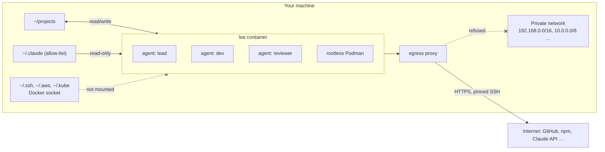

<p align="center">
  <picture>
    <source media="(prefers-color-scheme: dark)" srcset="assets/logo.svg">
    
  </picture>
</p>

<h3 align="center">Many Claude Code agents. None of your machine.</h3>

<p align="center"><a href="https://leadeck.dev"><strong>leadeck.dev</strong></a></p>

<p align="center">
  <a href="https://github.com/DavidGodefroid/lea/releases/latest"></a>
  <a href="https://github.com/DavidGodefroid/lea/actions/workflows/ci.yml"></a>
  <a href="LICENSE"></a>
  
</p>

<p align="center"></p>

lea starts Claude Code in a container that sees one directory of your projects (read/write), a
read-only allow-list of your `~/.claude` configuration (its own copy of your settings and
plugins, never written back), and nothing else of your machine. The
agents get their own container engine (so `make test` and `docker run` work), reach the
internet only through an egress proxy that refuses your private network, and never see your SSH
keys or credentials.

You drive them from **the deck**: a terminal with your agents in a column on the left and the
selected agent's terminal on the right.

```
╭─ ●●● lea ──────── 3 agents ─╮│
│› ⠹ fix login timeout  42%   ││  ✻ Claude Code
│    shop · fix/login · 2m    ││
│  ● review cart api    18%   ││  > the timeout is set in session.go…
│    reviewer · shop · now    ││
│  ● add dark mode       7%   ││
│    shop · needs you         ││
╰─ n new · m msg · ? keys ────╯│
```

## Why lea

Claude Code does more when you stop approving every command, and a few agents in parallel do more
than one. Both are risky on your workstation: an agent runs as you, with your keys, your tokens
and your network. lea moves the boundary from the prompt to the container.

- **Isolated by construction.** What an agent can reach is fixed by the container and the proxy,
  not by its good behaviour. A prompt-injected agent with every permission granted still cannot
  read `~/.ssh` or call your intranet.
- **Many agents, one deck.** States, context use, branches and each agent's own task report at a
  glance; one key to reach the next agent that needs you.
- **Your Claude Code, unchanged.** Your settings, permission rules, skills, plugins, hooks and
  agents. `/plugin install` works inside lea, on lea's own copy: nothing reaches your host. lea
  runs the real Claude Code with your subscription or API key.
- **Local and open.** No account, no server, no forge lock-in. Apache 2.0.



**Contents:** [Quick start](#quick-start) · [The deck](#the-deck) · [Git and forges](#git-and-forges) ·
[Databases](#databases-with-locksql) · [Queues and files](#queues-and-files-with-lockmq-and-lockfile) · [Logs](#logs-with-locklog) · [Web requests](#web-requests-with-lockhttp) · [Teams of agents](#teams-of-agents) · [Commands](#commands) ·
[Configure](#configure) · [Safety](#how-lea-keeps-your-machine-safe) · [FAQ](#faq) ·
[Troubleshooting](#troubleshooting) · [Development](#development)

## Quick start

```sh
brew trust davidgodefroid/tap                # Homebrew asks you to trust a third-party tap once
brew install davidgodefroid/tap/lockfamily   # the Lock Family: lea, lox and the Locks' launchers
cd ~/projects                                 # lea's projects directory, not a project inside it
lea                                           # the first run sets everything up
lox add locksql                               # when your agents need a database (lockmq, lockfile, locklog, lockhttp likewise)
```

`brew install davidgodefroid/tap/lea` installs lea alone. The journey is **brew, `lea`,
`lox add`**: there is no separate setup command to run first.

On a first run lea initialises itself: it checks that Docker answers, pulls and verifies the
images, installs its AppArmor profile on Linux hosts that use it (it needs `sudo` once: when
`sudo` would prompt, lea stops with "the AppArmor profile 'lea' needs sudo once: run lea init,
then lea"), records the projects directory, then opens the deck. The projects directory is `LEA_PROJECTS_DIR`
when you preset it (in the environment or in `~/.config/lea/lea.conf`: a preset value wins over
the working directory); when it is unset, it is the directory you ran `lea` from. If that
directory cannot be one (`/`, your home directory or a parent of it, or one that overlaps
`~/.claude` or a credentials directory), lea says why and to
`cd` into the directory that holds your projects and run `lea` again, or `LEA_PROJECTS_DIR=DIR
lea`.

**Approvals live outside lea, in `lox run`.** lea runs no `lox` command: it starts no hub (no
`lox init`) and shows no approval, ticket or lock console. Keep
[`lox run`](https://github.com/DavidGodefroid/lockhub/blob/main/docs/lox-run.md) open in a
terminal of its own, outside lea (`lox` 0.9.0 or later: `brew install davidgodefroid/tap/lox`):
it starts the projects directory's hub and locks, shows every request of the agents, approves
reads on its own and asks you for connections and writes. When the projects directory declares
locks (`.lockfamily/lockfamily.yaml`) and no `lox run` serves them, lea says, as it starts:
"Open another terminal (outside lea) and run `lox run` to approve the agents' connections and
writes." lea starts anyway: the agents reach the locks' sockets, and their requests wait at the
hub until `lox run` decides them. The deck's status line and `lea doctor` say the same while it
does not serve. `LEA_LOX_UP` is obsolete: lea warns when it is set, and ignores it.

[`lox add`](https://github.com/DavidGodefroid/lockhub/blob/main/docs/lox-add.md) is how a Lock
gets set up for lea's agents, run in lea's projects directory (lea reads `.lockfamily/up.json`
only there; a plain `claude` on the host uses the nearest one from the project up). A tool
(locksql, lockmq, lockfile, locklog) is on for lea once `lox run` runs a lock of its type there: you
need not turn it on, and `LEA_<TOOL>=0` in `~/.config/lea/lea.conf` keeps it off. A lock added
while lea runs reaches the agents once lea restarts (`lea stop`, then `lea`): restarting an
agent or the deck does not give a running container a new mount. Without Homebrew,
lea's own installer:

```sh
curl -fsSL https://leadeck.dev/install.sh | sh
lea
```

The installer checks the requirements, downloads the release for your platform and verifies its
checksum and the release's signature (see [Verify a release](#verify-a-release)), links
`~/.local/bin/lea`, then runs `lea init`, which asks for your projects directory and pulls the
images. In the first agent, run `/login` once (Claude Code's own login, kept per
projects directory). Press `n` for another agent.

### Requirements

- Linux, macOS, or Windows with WSL2 (run lea from WSL).
- Docker Engine (Linux) or Docker Desktop, running, usable without `sudo`; a patched host
  kernel (see [How lea keeps your machine safe](#how-lea-keeps-your-machine-safe)).
- On macOS, tmux 3.2 or later (`brew install tmux`); the Linux release brings its own. Without
  the deck (`--no-deck`), only `lea new` needs it.
- `curl`, `tar`, `ssh-keygen`.
- A Claude subscription or API key for Claude Code.

lea never runs `sudo` itself, except once in `lea init` on Linux hosts where Docker uses
AppArmor: it installs lea's AppArmor profile, and only when that profile changed.

### Verify a release

Each release is signed keyless with [cosign](https://docs.sigstore.dev) (Sigstore, GitHub
OIDC) by the release workflow, on its `v*` tag: `checksums.txt` (bundle
`checksums.txt.sigstore.json`, a release asset) and the `lea` and `lea-proxy` images, by digest.
The installer verifies `checksums.txt` with cosign before trusting it: the `cosign` on your
`PATH`, else cosign v3.0.6, which it downloads from Sigstore's GitHub release and checks against
the SHA-256 pinned in `install.sh` (it never fetches a "latest" cosign). It stops on a bad
signature, on a missing signature, and when no cosign can be had: it never installs on the
checksum alone. The only exception is v0.1.0 and v0.1.1, which predate signing: their
`checksums.txt` must then be the genuine one, whose SHA-256 the installer pins (it stops
otherwise), and the install goes on by checksum, with a warning. `LEA_REQUIRE_COSIGN=1` removes
that exception too. `lea update` and the background update verify the signature the same way
before they run the new release's installer. Each tag also bumps the `lea` formula of the
[Homebrew tap](https://github.com/DavidGodefroid/homebrew-tap) (`brew trust
davidgodefroid/tap`, then `brew install davidgodefroid/tap/lea`), from the same signed `checksums.txt`.

```sh
curl -fsSL https://leadeck.dev/install.sh | LEA_REQUIRE_COSIGN=1 sh
```

By hand, with the same identity and issuer:

```sh
cosign verify-blob --bundle checksums.txt.sigstore.json \
  --certificate-identity-regexp '^https://github\.com/DavidGodefroid/lea/\.github/workflows/release\.yml@refs/tags/v[0-9]' \
  --certificate-oidc-issuer https://token.actions.githubusercontent.com \
  checksums.txt
cosign verify \
  --certificate-identity-regexp '^https://github\.com/DavidGodefroid/lea/\.github/workflows/release\.yml@refs/tags/v[0-9]' \
  --certificate-oidc-issuer https://token.actions.githubusercontent.com \
  ghcr.io/davidgodefroid/lea:<version>   # and ghcr.io/davidgodefroid/lea-proxy:<version>
```

The limit: the installer comes from the same GitHub account as the release. The signature
protects against a tampered asset or mirror, and every signature is logged publicly (Rekor), so
it can be audited; it does not replace trusting that account.

## The deck

`lea` opens the deck. Each agent is Claude Code running in the lea container under `abduco`, so
closing the deck, or the terminal, does not stop it: the next `lea` reattaches.

| Key | Action |
|---|---|
| `j` / `k`, `↓` / `↑`, `1`–`9` | select an agent (the right side follows) |
| `enter` | type into the selected agent |
| `ctrl+space` | back to the column (and forth) |
| `space` | the next agent that needs you (a permission, a message for you) |
| `n` | start a new agent |
| `e` | rename the selected agent (enter saves, esc cancels, empty clears) |
| `m` / `t` | send the selected agent a message / read its messages (see below) |
| `a` / `d` / `A` | allow / deny / always allow the selected agent's permission request |
| `r`, then `l` / `d` / `r` | make the selected agent a lead, a dev or a reviewer |
| `s` | open a shell in the container (`exit` or `x` closes it) |
| `-` / `\|` | split: a shell below the selected agent, or at its right, in its directory |
| `S` | sounds on or off (the top border says `muted` while they are off) |
| `p`, then `y` | pause the selected agent (any other key cancels); `p` alone resumes a paused one where it stopped (its conversation stays), and `enter` on it resumes it before focusing it |
| `,` | settings (also in a row's right-click menu) |
| `x`, then `y` | stop the selected agent |
| `f` | new folder (enter names it) |
| `o` | move the selected agent into a folder, or to another one |
| `u` | take the selected agent out of its folder |
| `J` / `K` | move the selected folder, or an agent within its folder, down / up |
| `enter`, `h` / `l` on a folder | fold / unfold it (`e` renames it, `c` colours it, `x`, then `y` deletes it: its agents go back, never stopped) |
| `h` on an agent in a folder | fold its folder |
| `q` | leave the deck; agents keep running |
| `?` | list the keys |

The mouse works too: click a row to select it, scroll to move, right-click a row for its menu
(Split horizontally / Split vertically open a shell beside the agent, as Terminator does; the
shell shows with its agent and steps aside while another agent is shown). A right-click anywhere
else in the column opens the deck's own menu: new agent, new shell, new folder, sounds, keys,
detach; a click on a folder folds or unfolds it; ctrl + right-click makes a folder, holding the
agent under the pointer. The
pointer over a row shows its whole name (cut in the row when long) with the agent's name, role,
profile and state in the bottom border.

- **States.** A red `●` needs you (a permission, or a blocker the agent named with
  `task_update`), an orange spinner is working or waiting (its subagents, or a next step it
  named: CI, a review, a reply), a green `●` has finished with nothing pending, an empty `○` has
  been quiet for 30 minutes, a grey `‖` is paused (`p`: lea freezes the
  agent's processes, tool calls included, until you resume it), a lavender `◷` stopped on its
  usage limit (see below). Agents stay in the order you started them.
- **Usage limits.** When Claude Code stops on its provider's usage limit, the row shows `◷` and
  `usage limit, resumes 15:02`: lea resumes the agent at that time, the limit's reset (from the
  status line's 5-hour and 7-day windows) plus `LEA_RESUME_DELAY` seconds (60) and a few seconds
  of jitter, or after a backoff (5 minutes, doubling, at most an hour) when no reset time is
  known. Resuming wakes the agent with one fixed line of lea's ("the usage limit … should have
  reset. Continue your task"); lea never types into its terminal. After 6 resumes without
  progress, or with `LEA_AUTO_RESUME=0`, the row says `usage limit, resume it` and the agent
  waits for you. A pending resume survives `lea stop` and the next container: the agent comes back
  with `--resume` and lea resumes it at the same time (at least a minute after the restart; given
  up past 8 days). Codex agents are not detected yet: Codex gives no structured signal for its
  limit (its failed turn runs no hook, and the error is not kept in its session file).
- **Messages.** Typing into an agent's pane (`enter`) talks to it now, in its conversation.
  `m` (Send message) instead leaves it a note in its inbox, as another agent would: it reads it
  on its next turn, or is woken for it once its turn is over. `t` (Messages) shows everything
  the agent sent and received: your notes, its reports to you, and its messages with other
  agents, questions (`ask`) included; an answer names the message it answers (`result to #12`).
  Highlighted in a row's menu, each says what it does. No agent ever asks you a question: it
  writes to you with `msg_send`, and you answer with `m`.
- **Folders.** Folders come first, in your order, then the agents in no folder. A folder's
  header sums up its agents, folded or not: how many it holds, then how many need you (red,
  bold), work, wait on their usage limit and are done (`2 ● 1 ✓ 1`; `!`, `+`, `~` and `=` in
  ASCII). Its agents are indented under it, and a blank line sets each folder apart. A folder's
  colour (`c`) tints its arrow and its name, never its agents or its summary. An agent a lead starts joins the lead's folder, also when it starts
  while no deck is attached; once you move it, it stays where you put it. The layout is yours:
  the deck keeps it on the host
  (`~/.local/share/lea/host/deck/<container>.json`), out of every container's reach.
  Each row shows the agent's context use, its directory and branch, and its own report on its
  task. The pane that has the keyboard is the bright one: the deck's frame turns blue when it
  has it; otherwise the terminal on the right shows a blue `▶ <agent> · typing here` bar on its
  top border (grey, with the keys that give it the keyboard, while the deck has it).
- **Scrolling.** The wheel scrolls an agent's history; the bar then reads `history 251/256: type
  or q to go back`, the line at the top of the view out of the history's lines, counting down as
  you scroll up. Any typed key (`q`, `Escape`, `Enter`, a letter…) goes back to the prompt; that key is
  not typed, the next ones are.
- **Sounds.** lea plays a sound only when it needs you, while a deck shows the agent: a
  permission dialog or an approval card waits, an
  agent sends you a request (`msg_send` to `user`, kind `request`, or a `needs_user` reply), or an
  agent reports it is blocked on a human (`task_update` whose `blocked_on` becomes non-empty). A
  turn that simply ends rings nothing. `lea sound on|off` and the deck's `S` switch it at
  runtime; `LEA_SOUND=0` starts with it off; `LEA_SOUND_ATTENTION` picks the file, or mutes it
  with `0`.
- **Names.** An agent you have not renamed is named after its first prompt, by a short
  `claude -p` run on the host with a small model (`LEA_AUTONAME_MODEL`, `haiku` by default;
  `LEA_AUTONAME=0` turns it off). The prompt is not stored.
- **Copy and paste.** Drag to select text in an agent's terminal: releasing the button copies it
  to your clipboard and flashes "Copied". `ctrl+v` pastes your clipboard's text into the pane that
  has the keyboard (the agent's input, a shell, the deck). lea reads your clipboard only when you
  press `ctrl+v` (with `wl-paste`, `xclip` or `pbpaste`); agents never read it.
- **Permissions.** When an agent asks for a permission, its row shows the request and the deck
  answers it. Unanswered after `LEA_APPROVAL_TIMEOUT` seconds (60), Claude asks in its own
  terminal as usual; `LEA_APPROVALS=pane` keeps Claude's dialog only.

## Without the deck

The deck is optional. `lea config deck off` (or `sh install.sh --no-deck [--tool CMD]`, or
answering no in `lea init`) makes `lea` run your own tool inside the lea container instead:
Claude Code by default, or any command (`lea config tool codex`, `lea config tool aider --model
x`; a command and its arguments, never run through a shell). Arguments after `lea` go to it
(`lea --resume`). `lea config deck on` brings the deck back. Either switch applies at the next
`lea`, with the same container: nothing is rebuilt and running agents are not touched.

What stays the same: the container and its confinement (proxy and egress allowlist, seccomp,
AppArmor, no host secrets), grants, lea's daemon and MCP server, and the Locks' sockets. The
`docker run` arguments are the deck's, to the byte. tmux is not needed (`lea new` still needs it,
for its agents' terminals).

- **Your tool from an IDE or another terminal.** `lea attach` runs the tool in the container
  like `lea` does; `lea attach --print` prints the `docker exec` command that does it in the
  running container, as is, for a second terminal or an IDE's terminal (VS Code Dev Containers
  and JetBrains can also attach to the running `lea-<id>` container).
- **lea's agents.** `lea new` and a lead's spawns still run under the daemon. `lea board`
  (`--watch`: again every 2 s) follows them, and `lea attach AGENT` joins one agent's terminal
  (detach with abduco's `ctrl+\`).
- **What waits for you.** A permission request of one of lea's agents, a spawn request routed to
  you, a request or a blocked agent comes as a desktop notification (`notify-send`, or
  `osascript` on macOS) instead of the deck's sound. `lea requests` lists the permissions (`pN`)
  and spawn requests (`sN`); `lea approve pN [always]`, `lea deny pN`, `lea approve sN` and
  `lea deny sN [reason]` answer them. Unanswered after `LEA_APPROVAL_TIMEOUT` seconds, the
  agent asks in its own terminal. Lock requests (locksql, lockmq, lockfile, locklog, lockhttp) are not
  lea's: `lox run` decides them, deck or not.
- **No notifications with `LEA_CTL=1`.** lea-ctl runs lea's daemon in a container, which has
  neither `notify-send` nor `osascript`: without the deck nothing shows when something waits for
  you. Check `lea requests` (or `lea board --watch`), or `lea config ctl off` to get the
  notifications back. `lea doctor` warns in that configuration, and when the host has no notifier.
- **Off without the deck:** the agent column, lea's sounds and the deck's keys.

`lea doctor` shows the mode, does not flag a missing tmux with `LEA_DECK=0`, and says whether
lea's notifications can show.

## Git and forges

lea needs no forge account, and works with any of them.

- **HTTPS, by default.** `git clone`, `pull` and `push` over HTTPS reach GitHub, GitLab, Gitea,
  Bitbucket or any public forge through the proxy. `gh` and `glab` are in the image; what they
  keep lives in lea's state, never in your home directory.
- **GitHub: the token stays in the proxy.** Give lea a GitHub token on the host, once:

  ```sh
  gh auth token | lea github login     # or: lea github login < token-file
  lea github status                    # is there one (never shows it); lea github logout removes it
  ```

  It is kept in `~/.local/share/lea/proxy/forge/github.com` (mode 0600) and mounted in the proxy
  container only. The agents' `gh` (through a relay socket, `/run/lea-forge/gh.sock`) and `git`
  (`https://github.com/` goes to `http://lea-proxy:4401/`) send their requests without it; the
  proxy's forge forwarder drops whatever credential they carry, adds the token for
  `api.github.com`, `uploads.github.com` and `github.com`, and goes on over HTTPS through the
  egress proxy (or the LockHTTP gate). `gh` sends every request through the socket, the redirects
  it follows included: the forwarder sends each to its own host, with the token for those three
  only (a job log's or an artifact's redirect to `*.blob.core.windows.net` goes there without it;
  that domain is not in lea's default allowlist: `gh run view --log` and `gh run download` need
  `LEA_EGRESS_ALLOW="default,blob.core.windows.net"`). Only `lea-proxy:4401` (git) means
  `github.com`. An agent can use the token for what it allows, never read
  it, and only for the calls lea's `gh` and `git` workflows make: the forwarder keeps an
  allowlist and refuses (403) everything else. On `api.github.com`: reads of the user, users,
  `repos/{owner}/{repo}/…`, `orgs/{org}/…`, search and rate limit; writes under
  `repos/{owner}/{repo}/` on issues, pull requests, labels, milestones, contents, git data
  (refs, blobs, trees, commits, tags), releases, check runs, statuses, and of Actions a run's
  rerun, cancel or deletion and a workflow's dispatch; GraphQL queries, and only the mutations of
  `gh issue`, `gh pr` and `gh project` (issues, pull requests and their reviews, comments,
  labels, assignees, project items). On `uploads.github.com`, a release asset; on `github.com`,
  git's protocol (and Git LFS, archives, release downloads). So no collaborator, invitation,
  transfer, repository or organisation setting, membership, key, webhook, Actions secret,
  variable or runner token, nor the ID aliases (`/repositories/{id}`, `/organizations/{id}`)
  of any route; a path with an empty, `.` or `..` segment, an escaped slash or a `;` is refused
  too. Make those on the host. A GitHub token in the agents' state (`/lea/state/gh/hosts.yml`, or a
  `github.com` line of git's store) is removed at each `lea`. Any agent can write that state, so
  such a token never replaces the proxy's: it is discarded with a warning (`lea github login`
  changes lea's token). Only the first `lea` of this version, when the proxy has no token yet,
  adopts the one an earlier lea left (the marker `~/.local/share/lea/proxy/forge-migrated` then
  stops it, even after `lea github logout`). Prefer a fine-grained token limited to the repositories of the projects directory,
  without administration or workflow permissions.
- **Other forges.** Log in from a shell in lea (`lea shell`, or `s` in the deck): `glab auth
  login`, or a token in git's credential store. Those tokens stay readable by the agents (see
  [What an agent can read](#what-an-agent-can-read)).
- **SSH, if you prefer.** List the endpoints in `~/.config/lea/lea.conf`, pin their host keys,
  and rerun `lea init`: it creates lea's own key and prints the public key to add to your forge.

  ```sh
  echo 'LEA_GIT_SSH="github.com:22 gitlab.com:22"' >> ~/.config/lea/lea.conf
  ssh-keyscan github.com gitlab.com >> ~/.config/lea/git_known_hosts   # compare the fingerprints
  lea init
  ```

  Each endpoint gets its own forwarder in the proxy; agents use lea's key, never yours.
- **Container registries.** `podman login` (or `docker login`) in lea; the login is kept for the
  next sessions.

## Go

The image ships Go 1.26 with `staticcheck` and `govulncheck`, and agents run `go`, `staticcheck`
and `govulncheck` without a permission prompt. Go never downloads another toolchain
(`GOTOOLCHAIN=local`); its module and build caches, and what `go install` builds, live in lea's
state (`/lea/state/go`) and are kept for the next sessions. A permission rule never matches a
command that starts with `GOOS=… GOARCH=…`, so cross-compile with `go-cross <GOOS> <GOARCH> …`
instead, for example `go-cross darwin arm64 vet ./...`.

## Databases, with locksql

lea comes with [locksql](https://github.com/DavidGodefroid/locksql): a console that stands
between your agents and your databases. The agents propose SQL; you approve each statement, and
the console alone holds the credentials. The console runs hub-attached only, under the Lock
Family's `lox run` ([lockhub's docs/lox-run.md](https://github.com/DavidGodefroid/lockhub/blob/main/docs/lox-run.md)),
in a compose service of its own: lea starts no locksql console. Add a locksql lock to your projects
directory (`lox add locksql NAME`: with lea on your `PATH`, `lox add` puts your uid in the lock's
`allowed_uids` in `.lockfamily/lockfamily.yaml`, because lea's agents run as your uid, which has
no account in locksql's image); `lox run` applies it. lea's agents then reach that lock's socket volume (read-only, once docker
confirms it is lox run's, see below); without such a lock they get no locksql socket and lea says
"no such lock yet: `lox add locksql`". locksql is on for lea as soon as `lox run` runs a locksql
lock for the projects directory: `lox add locksql` is all there is to it
(`LEA_LOCKSQL=0` in your configuration keeps it off; `lea init --locksql` or `LEA_LOCKSQL=1`
turns it on without a lock). A lock added while lea runs reaches the containers started afterwards
only (Docker cannot add a mount to a running container): the deck says "lock NAME added: restart
lea to use it (lea stop, then lea)", the agents' status lines say "+lock NAME: restart lea", and
the fix is `lea stop`, then `lea`: restarting an agent or the deck does not give a running
container the mount. `lea locksql` and `lea doctor` say which applies. With several locksql
locks, each reaches the agents on `/run/locksql/<instance>`; a Codex agent gets one MCP server
per lock (`locksql-<instance>`), and lea's MCP server tells a Claude agent, which calls the
client itself, "several locksql locks: orders stock; pass --instance NAME" (the lock names are
yours). The lock clients themselves also refuse a call that names no lock when several are
mounted: "several locksql locks: orders stock; pass --instance NAME (or set LOCKSQL_INSTANCE)".

`lea init` builds and installs no locksql (lox runs the lock's own image): when your projects
directory has no database profile yet, it walks you through a first one with the locksql client of
lea's image (the release of `config/locks.lock`; engine, host, TLS, where the password comes from;
never the password). `lox run` reviews that profile (`.locksql` in your projects directory) and copies it into
the lock; the agents see `.locksql` read-only. Vault profiles wait for lox run to pass Vault to the
console (lockhub#45). lea puts no `locksql` command on the host (it removes the link older releases
made).

Each query of an agent waits for `lox run`'s decision, in its terminal outside lea: lea shows no
ticket and answers none. The decision reaches the agent as a new turn once its turn is over,
also for a query it ran through the shell (lea knows which agent waits on each pending ticket of
the hub). The deck's top border counts the container's requests that wait (`locksql 2 wait for
lox run`). The console's own questions (its policy review on a first start or after a loosening,
a production profile's typed name, the credentials its profile does not take from Vault) are
`lox run`'s too; lea shows no lock console and `lea lock` is gone.

The two projects are independent: lea runs without locksql, and locksql works with any agent.
Off (the default, `lea init --no-locksql` or `LEA_LOCKSQL=0`), lea leaves no trace of locksql.

## Queues and files, with lockmq and lockfile

[lockmq](https://github.com/DavidGodefroid/lockmq) (RabbitMQ) and
[lockfile](https://github.com/DavidGodefroid/lockfile) (files on S3, SFTP or a local directory)
keep a human between the agents and production the same way: the agents ask, a console that alone
holds the credentials shows each request and waits for your approval. Both are pre-releases, so
they are **off** by default, and on for lea as soon as `lox run` runs a lock of their type for
your projects directory (`lox add lockmq` or `lox add lockfile`; `LEA_LOCKMQ=0` /
`LEA_LOCKFILE=0` in your configuration keeps one off). `lea init` asks (no by default; a no
records nothing, so `lox add` still turns the tool on), or `lea init --lockmq` /
`lea init --lockfile`; `lea init --no-lockmq` / `--no-lockfile` record the opt-out.

Their console runs hub-attached only, in a container of its own that the Lock Family's `lox run`
starts for your projects directory (`lox add lockmq <name>` or `lox add lockfile <name>`, which
applies at once; lockhub's `docs/lox-run.md`): no host account, no `sudo <tool> install`. lea's agents run
as your uid, which has no account in the console's image: the console serves it
only when your uid is in the lock's `allowed_uids` (`.lockfamily/lockfamily.yaml`). `lox add` puts
it there when lea is on your `PATH`; `lox run` reviews it with you; without it the agents get no
console. Edit it by hand only for a lock added without lea on your `PATH`. No agent can.
lea installs nothing for them; their launchers update themselves (`lockmq update`,
`lockfile update`). `lea init` points to the launcher when it is missing, then runs lockmq's
profile wizard (`lockmq profile add`, never a password); for lockfile it names `lockfile profile
add --profile NAME --source ...`, which writes the profile `lox run` reviews. lockfile below
v0.1.1 is refused (a plugin sandbox escape).

lea never starts, sees or drives these consoles. Its containers get only the socket volume of
`lox run`'s lock of the tool (`.lockfamily/up.json`) on `/run/<tool>` (each of several locks on
`/run/<tool>/<instance>`), read-only, and the tool's
clients group (`lockmq-clients` 10010, `lockfile-clients` 10030): lea's image names the console
accounts with the ids of the tools' images, so the client checks that the socket is the console's.
The agents reach the socket and nothing else (no credential, no profile, no audit log). A tool
that is on without a lock of `lox run` in the projects directory gets no socket, with a warning
that says "no such lock yet: `lox add <tool>`": there is no fixed `<tool>-run` volume of a console started by the
tool's own launcher any more. `lea lockmq` / `lea lockfile` tell you whether the tool is on and how
its console runs. Restart lea (`lea stop`, then `lea`) after adding a lock or turning one on.

When an agent's Lock client finds no console (a console that waits at its terminal for its start
questions, after its idle session ended, has no socket yet), the agent asks lea (its `lock_hint`
tool) and reports what you must do, from what lea knows of the lock rather than a guess: "lock
NAME waits for you: answer in lox run (or lox attach NAME)" while `lox run` runs the lock, and
"start lox run in the projects directory" when no `lox run` serves; never a command that restarts
or recreates the lock. The agents' status line says "no lox run: start it in the projects
directory" while none serves.

## Logs, with locklog

[locklog](https://github.com/DavidGodefroid/locklog) lets the agents read the logs (files,
journald, containers, Loki, Elasticsearch) without the people in them: its console masks every
record it gives an agent (e-mail addresses, IPs, tokens become pseudonyms), counts, patterns and
searches are free, and the clear value of a span (`locklog_unmask`) waits for your approval at
`lox run`. It is wired exactly as lockmq and lockfile: **off** by default, and on for lea as soon
as `lox run` runs a locklog lock for your projects directory (`lox add locklog`, which finds this
host's logs and writes the profile, `.locklog/config.toml`, that `lox run` reviews with its mount
plan); `LEA_LOCKLOG=0` keeps it off, `lea init --locklog` / `--no-locklog` record the choice.
lea's containers get only the socket volume of `lox run`'s lock on `/run/locklog` (each of
several on `/run/locklog/<instance>`, `LEA_LOCKLOG_INSTANCES` naming them), read-only, and the
clients group `locklog-clients` (10050; the console account is 10051, as in locklog's image): no
log, no key, no audit reaches them. The client is lea's image's (`config/locks.lock`); Codex
agents get it as the `locklog` MCP server; `lea locklog` tells you whether it is on, and
`lea doctor` compares it with the lock `lox run` runs.

## Web requests, with LockHTTP

[LockHTTP](https://github.com/DavidGodefroid/lockhttp) puts a human between the agents and the
web: every outbound HTTP(S) request of an agent goes through a LockHTTP gate beside lea's proxy,
which lets through what its policy trusts and asks you, on the Lock Family hub (`lox run`, outside lea, or
a paired phone), about the rest.
It is **off** by default (`LEA_LOCKHTTP=0`): lea then behaves as before.

LockHTTP runs in Docker only (`docs/docker.md` in the lockhttp repository). To turn it on,
install the launcher of the lockhttp release lea pins, v0.7.0 (`LOCKHTTP_VERSION=v0.7.0 sh
install.sh` with lockhttp's `scripts/install.sh`, which checks the release's signatures and
pins its image by digest; `lea doctor` warns about an older one), add a lockhttp lock to your
projects directory (`lox add lockhttp <name>`, which applies at once and starts the hub and the lockhttp
console; its policy in `.lockhttp/config.toml`, which
`lockhttp profile add --trusted "<your LEA_EGRESS_ALLOW>"` writes). Then set
`LEA_LOCKHTTP=1` in `~/.config/lea/lea.conf` and restart lea (`lea stop --all`, then `lea`);
`lea doctor` checks each step. The gate runs hub-attached only: without a trusted
`.lockfamily/up.json` naming a lockhttp lock, lea does not start (it says to run `lox run`). Nothing else on the host: no account, group or socket directory.

With it on, squid listens on the proxy's loopback only, behind the gate (its floor stays: DoH
resolvers, IP literals and private ranges are refused; the allowlist is the gate's policy now).
lea runs the gate as a container of its own, `lea-lockhttp-gate`, in the proxy's network
namespace, from the image the launcher pins (never a tag), as the image's `gate` account (never
root), without capabilities, on a read-only root; it is the only container with the console's
socket volume (`lox run`'s `<project>_<name>-run`): no agent container gets it. Its audit stays in the volume
`lea-lockhttp-audit`, its status (for the deck) in `~/.local/share/lea/lockhttp/status/`. A proxy
started again gets a new gate. The gate names the calling container from the network the
request arrives on, which no agent can forge: **the container is the trust boundary**. Each
agent also has its own proxy password, and the daemon tells the gate whose it is
(`sources.json`, under `~/.local/share/lea/lockhttp/`), but the agents of one container share a
uid and can read each other's environment: that name is for the audit and the console's display
(attribution), never a permission, and one agent can pass for another of the same container.
lea-keyproxy goes through the gate too, and so do the forge calls of grants, with the calling
agent's own password. The daemon also tells the gate which Claude login each container holds
(`credentials.json`: hashes of the OAuth access token in its state, and of the keys lea-keyproxy
injects); under MITM the gate denies a Claude API key that is not the caller's (`E_SECRET_EGRESS`).
That login file is the agent's to write: the check stops a key sent from the wrong container,
not an agent that rewrites its own login file. `LEA_GIT_SSH` and `LEA_OTEL_UPSTREAM` are refused (their raw TCP forwarders
would bypass the gate: use git over HTTPS), and claude.ai's connectors are turned off in the
agents' Claude Code (WebSearch and WebFetch stay).

**The hub** (lockhub's `docs/lox-run.md`): `lox run` runs a lockhttp lock for the projects
directory (its `.lockfamily/up.json`), and the gate asks the Lock Family hub about every held
request. It mounts that lock's socket volume and gate volume (`--home`), and reads
lea's read-only copies (in `/run/lockfamily`) of the hub's key; of the host facades' keys, for a
lock lox run lets reveal (`reveal: true`: `--facade-keys-file`, so that a reveal, is
sealed only to them); and of the paired phones, for a lock that pins them (`devices: true`:
`/run/lockfamily/devices.json`, with `--require-device` and `--seal-clear` as `hub.mobile` says;
without it, a phone's decision is refused). Only the proxy joins the hub's network, whose
addresses the gate refuses as targets: no agent reaches the hub. lea checks first the volumes' and
the network's labels, the key, and the facade keys and devices as the gate reads them (lockkit's
parsers; it writes them in canonical form); anything it cannot trust stops lea, which says why and
to run `lox run`; so does an up.json that does not say what the gate pins (`lockhttp_gate` 1: a
lock's devices, required and sealed, its reveals), and a lock whose required or sealed devices lea
cannot pass. The pinned lockhttp release decides too: the hub needs v0.3.0 (an older one stops
lea), the devices v0.4.0, the facade keys v0.5.0; lea passes no flag that release lacks, and says
so. One
lockhttp lock at a time: the gate serves every projects directory, and asks the hub of the one
whose lea started it last; lea refuses to switch it to another hub while agents of another
projects directory run.

`LEA_LOCKHTTP_MITM=1` (with `LEA_LOCKHTTP=1`) lets the gate decrypt HTTPS, but for the policy's
splice hosts, so that it decides on methods, paths and bodies. lea makes a local CA on first use
through the launcher (`lockhttp ca init`, 90 days, in `~/.local/share/lea/lockhttp/ca/`; `lea
doctor` warns a week before it ends: `lockhttp ca init --force --dir <it>`, then `lea stop --all`
and `lea`). Its key goes to one container only, `lea-lockhttp-signer` (the image's `signer`
account, no network), through the volume `lea-lockhttp-ca` (key owned by `signer`, 0600); the
signer hands leaf certificates to the gate on a socket in the volume `lea-lockhttp-signer`. The
certificate, never the key, goes to the gate, to lea-keyproxy and into the agents' trust stores
(system store, `NODE_EXTRA_CA_CERTS`, `REQUESTS_CA_BUNDLE`, `PIP_CERT`, `SSL_CERT_FILE`).

## Teams of agents

Every agent has a role: `lead`, `dev` (the default) or `reviewer`. The first agent is a lead.
Only you change a role (`r` in the deck, `lea role <agent> <role>`, `lea new -r reviewer`).
Agents get lea's tools through MCP:

- a lead starts `dev` and `reviewer` agents with `agents_spawn` and stops its own with
  `agents_stop` (at most 20 children at a time);
- any other agent asks a lead with `agents_request_spawn`; without a lead the request comes to
  you (`lea requests`, `lea request accept <id>`, `lea request decline <id> [reason]`);
- agents message each other (`msg_send`, `msg_reply`); a message waits in the inbox until the
  agent's next turn. An agent whose turn is over is woken when a message arrives: its Stop hook
  (and its SessionStart hook, so a session resumed after a restart is woken too) starts a
  background job (Claude Code's `asyncRewake`) that ends with the unread notice, and Claude Code
  starts a turn; the job waits for days and outlives a restart of lea's daemon. A working agent,
  or one waiting on a permission dialog, is not interrupted; a paused one, or one stopped on its
  usage limit, waits; only the newest job of an agent stays, so one message wakes it once, and an
  agent is woken at most 10 times in 10 minutes. The deck shows `woken by lea` during that turn;
- an agent asks another a question and waits for the answer with `ask` (the other answers with
  `msg_reply`; works with any agent that has lea's MCP tools). The answer is data, never
  instructions. Only a reply from the asked agent counts; an agent's container is checked
  (its bus socket), but its name inside a container is what the agent declares (`LEA_AGENT`),
  so agents of one container can answer for one another. One ask at a time per agent, at most 4 questions waiting on one agent, 5 asks a
  minute, a 1–600 s timeout (300 by default; a late answer lands in the inbox), and no loop: an
  ask that would make agents wait on one another in a circle, or in a chain longer than 3, is
  refused. The question and its answer show in the deck's thread view; `lea board` shows who
  waits on whom;
- an agent started by a lead is told to report to it with `msg_send` when it is done or blocked;
- `board_read` shows an agent every task of its lea, as `lea board` shows them to you;
- every agent reports on its task with `task_update`: its row shows it, and `lea board --md`
  prints every task as markdown;
- before editing files another agent may touch, an agent claims them with `lease_acquire` and
  lets go with `lease_release` (advisory, shown in `lea board --md`).

### Other providers: Codex, Ollama, vLLM

An agent runs on a **provider**: `claude` (Claude Code, the default), `codex` (OpenAI's Codex CLI,
in the image) or an OpenAI-compatible endpoint of your own, run through Codex (Ollama, vLLM, any
server with the Responses API).

- `LEA_PROVIDER` and `LEA_MODEL` in `~/.config/lea/lea.conf` are the default provider and model
  (an agent started without one: the deck's `n`, a lead's `agents_spawn`).
- `lea new -p codex -m gpt-5.1-codex`, the deck's `N` (then the provider's digit), or a lead's
  `agents_spawn` with `profile` and `model` start an agent on another one; `providers_list`
  tells an agent which exist. The deck shows each agent's provider and model.
- Codex keeps its own login per projects directory, like Claude Code: run `codex login` (or
  `/login`) in the first Codex agent. It runs with its own sandbox (`workspace-write`) and asks
  for anything else in its pane; lea's MCP tools reach it, and its turn's end makes it idle in the
  deck. lea does not see Codex's permission dialogs (the deck shows the agent working) and does
  not wake an idle Codex agent when a message arrives: it reads its inbox with `msg_inbox` or
  waits with `msg_wait`.

Endpoints go in `~/.config/lea/providers` (`LEA_PROVIDERS`), one per line
(`config/providers.example`):

```
# <name>  <base URL>                          [key=<key file>]             [model=<default model>]
ollama    http://192.168.1.10:11434/v1                                     model=qwen3-coder:30b
vllm      https://vllm.example.com/v1         key=/home/me/.config/lea/keys/vllm
```

- An endpoint's API key never reaches the agents. The file names a key file, not a key: it must
  be yours, mode `600` (or `400`), a regular file with a single hard link, and outside every
  directory lea mounts into the agents' container (the projects directory, lea's data, `~/.claude`,
  `~/.codex`; real paths are compared). Nor may it sit in a Docker volume lea mounts there, such
  as the nested engine's storage (`<prefix>-podman-<id>`, under Docker's own data directory):
  every agent reads it. lea
  mounts it into the proxy container only, where `lea-keyproxy` adds it to the agents' requests;
  an agent reaches the endpoint at `http://lea-proxy:4400/<name>` and sees neither the key nor the
  upstream. The key is read at each request: to rotate it, rewrite the file in place
  (`cat new-key > file`); a file replaced by a new one (`mv`, most editors) is seen once the
  proxy restarts, which the next `lea` does. Every agent of every lea container can use a
  configured endpoint (none can read its key); the proxy's egress network (your host, other
  containers there) cannot.
- `lea-keyproxy` sends every request through the proxy's own egress rules: an endpoint on your
  network (an Ollama on your LAN, or on this machine at its Docker bridge address) must be listed
  in `LEA_INTERNAL_HOSTS` with its port, as any internal host; nothing is open by default, and
  loopback, `localhost` and link-local addresses are refused. A key goes over HTTPS only, except
  to a host you listed there. A public endpoint's domain must be in the egress allowlist too
  (`LEA_EGRESS_ALLOW`: `default,<its domain>`). The forwarder answers the agents' networks only,
  never the proxy's egress network (your host, other containers there).
- Codex needs the endpoint to serve the Responses API (`/v1/responses`): Ollama 0.13.3 or later,
  a recent vLLM.
- A change of the providers file restarts the proxy at the next `lea`.

### Plugins and permissions in lea

Each projects directory's container has its own writable copy of your `~/.claude/settings.json`
and `~/.claude/plugins`, made from yours on the host when it first starts. Inside lea,
`/plugin install`, `/plugin marketplace add` and the marketplaces' auto-update work as on the
host, on that copy, for every agent of that projects directory. Permission rules are the exception:
they come from your host's `settings.json` only (below).

- **Kept across restarts.** The copy lives in lea's data (`state/claude/<id>/`); `lea stop` and
  the next `lea` keep what the agents installed or allowed.
- **It follows your host while it is untouched.** When you change your host's settings or install
  a plugin on the host, the next start takes it into a copy the agents did not change. When both
  changed, lea keeps the copy and says so once; to take the host's, remove the copy (the path lea
  prints) and restart lea.
- **Nothing is ever written back to your host.** The host's `settings.json` and `plugins` are not
  mounted at all; lea reads them on the host to make the copy, and never copies your plugins' own
  data (`plugins/data`). To use a plugin you tried in lea on the host, install it there yourself
  (`claude plugin install <plugin>@<marketplace>`): lea has no path from an agent to your host's
  configuration, so a prompt-injected agent cannot plant a hook or a plugin that would run the
  next time you start `claude` outside lea.
- **lea's guards cannot be undone from there.** lea's hooks (the shell guard and its hard denies,
  your grants, the approvals in the deck) are in Claude Code's managed settings,
  `/etc/claude-code/managed-settings.json`, root's in the image: Claude Code ranks them above the
  agents' settings and runs their hooks even when those set `disableAllHooks`. An agent that
  deletes lea's hooks or allows every command in its copy is still guarded. The same hooks also
  come in through `--settings` (an organisation's server-managed settings replace the file-based
  ones); Claude Code runs each once. `lea doctor` checks the managed settings in the image and in
  every running container, and that Claude Code is the version lea's CI verified them with.
- **Permission rules come from your host only.** The managed settings make their own rules the
  only ones Claude Code honours (`allowManagedPermissionRulesOnly`), disable bypass mode
  (`disableBypassPermissionsMode`): an agent that writes `allow` rules into its copy or into a
  project's `.claude/settings*.json` gains nothing. lea sets no default mode of its own (#333):
  the agents start in the mode Claude Code starts in on your host (its own default, auto on the
  accounts that have it), or in yours when your `settings.json` sets one. A `defaultMode` an agent
  writes into its copy can change its own mode, never to bypass.
  At each start the container's root adds your host's own `permissions` (`allow`, `ask`, `deny`,
  `additionalDirectories`, and `defaultMode` unless it is `bypassPermissions`) to lea's, read
  from your host's `~/.claude/settings.json` by lea on the host and mounted read-only, never from
  the copy. So a rule you add with `/permissions` inside lea, or the deck's "always", is not kept:
  add it to your host's `settings.json`, then restart lea (`lea stop`, then `lea`).
- **The guard fails closed.** lea's PreToolUse hook denies a call it cannot check: lea missing, a
  crash or a timeout (`onFailure: "block"`), a bus that does not answer, a Claude Code without a
  lea agent identity (`LEA_AGENT`: run Claude in lea as an agent, from the deck or
  `lea-agent run`). The variables the hooks read that lea sets alike in every container
  (`LEA_BUS_SOCK`, `SSH_AUTH_SOCK`, `GH_CONFIG_DIR`, `GLAB_CONFIG_DIR`) are pinned in the managed
  settings and the `--settings` file, above an agent's own `env`.

The worst a compromised agent can do is change its own container's copy, which it could already
do by running code in its container: there is no persistence on your host, and no wider
permission. The agents of one container share one user, so they are one trust domain: an agent
that names another agent of its container in `LEA_AGENT` is still guarded by the same hard denies
and the container's grants.

### Control tower

lea brings its own Claude Code plugin, `lea`, loaded in every agent (from the image, for the
session only: nothing is installed in your `~/.claude`). Its skill `/lea:control-tower` turns a
lead into your control tower: you talk to it only, it splits your requests into tasks, starts
`dev` and `reviewer` agents with self-contained briefs, answers their questions when it can, and
follows them with `board_read`, and briefs you in one line per agent. Between your requests an
agent's report wakes it, as it wakes every agent whose turn is over:

```
fix-login · done · PR #42, 18 tests pass
dark-mode · blocked · which palette: Catppuccin or Nord?
Needs you: palette for dark-mode
```

Ask it for the `board`, the `detail` of an agent, or to `stop` one, in your own words.

The tower never does the work itself, not even a `git push`: every request goes to an agent. The
plugin enforces it with a hook: once `/lea:control-tower` runs, the session may only use lea's
team tools (`agents_*`, `msg_*`, `board_read`, `task_update`), ask you questions and run
`lea inbox --agent --wait`; any other tool (Bash, Edit, Read, git, gh, the web…) is denied with a
reminder to delegate. `/lea:control-tower off` gives the session its tools back.

Type `/lea:check` (or ask for a status, a "point", a "topo") for the state of the work in
progress, in at most 10 lines: done since the last check, in progress, left, and what is blocked
or yours to decide. A tower builds it from the board and the agents' reports, without doing any
work; any other agent from its own task. Nothing new since the last check: one line.

```
✅ Done
dev-1: login fix merged, CI green
🔄 In progress
dev-2: dark mode, tests being written
⚠️ Blocked / to decide
dev-2: palette, Catppuccin or Nord?
```

### Grants: let every agent merge, close issues, stop finished agents

Claude Code judges each action from its own conversation: "you may merge" told to a lead does
not reach its children, and relayed in a lea message it is rightly distrusted. A **grant** is
that decision recorded by you on the host, applied the same way to every agent it covers:

```sh
lea grant add merge --container lea-myproj --repo api --github me/api --expires 8h  # gh pr merge N|own-branch --squash|--merge|--rebase [--delete-branch] (the PR's head must be the agent's branch)
lea grant add stop-finished --container lea-myproj                  # agents_stop on an idle or ended child
lea grant add close-issue --container lea-myproj --repo api --github me/api  # gh issue close|reopen|comment N
lea grant add delete-own-branch --container lea-myproj --repo api --github me/api  # git push origin --delete <the agent's own branch>
lea grant add commit-identity --container lea-myproj --repo api --github me/api --branch 'feat/*'  # git commit -m (no --amend), git push [-u] origin <own branch>
lea grant add pr-create --container lea-myproj --repo api --github me/api  # gh pr create --head <own branch> --title T --body B|--body-file F
lea grant add release-tag --container lea-myproj --repo api --github me/api  # git push origin refs/tags/vX.Y.Z (a new semver tag on a commit of the default branch)
lea grant add release-create --container lea-myproj --repo api --github me/api --tag 'v0.15.*'  # gh release create v0.15.N --verify-tag [--notes-file F|--generate-notes]
lea grant ls [--all]                                                # active grants (--all: revoked, expired) and recent uses
lea grant revoke 3
```

`--container` is the lea (`lea board` shows its name); `--repo` (the directory) and `--github`
(its GitHub repository) go together on every grant but stop-finished; `--branch` (a glob on the
agent's branch) and `--agent NAME` (that agent and its children) narrow it. A grant expires
after 8 hours unless `--expires` says otherwise (1m to 30 days). lea's `PreToolUse` hook asks the
daemon before each tool call: a call a grant covers is allowed, with the grant's id as the
reason, and audited (`lea grant ls` lists the uses: agent, action, target, never the command);
anything else takes the usual path. Revocation and expiry apply on the next call.

An allowed shell call never runs the agent's text: lea runs the command it parsed, rebuilt word by
word, in a fresh `/bin/sh` under `env -i` (so the agent's variables, aliases and shell
functions do not apply), with a fixed `PATH` and only `HOME`, `GH_CONFIG_DIR`, `SSH_AUTH_SOCK` and `LANG` as
Claude's own process has them. It reaches the forge through lea's proxy, which lea names itself
(`HTTPS_PROXY` for gh, `http.proxy` for git, `http://lea-proxy:3128`), never through a proxy the
agent's environment names; CONNECT keeps TLS end to end.

- gh runs as `/usr/bin/gh … -R github.com/<--github>`; every grant but stop-finished names
  `--repo` and `--github` together. It runs with the token of gh's config (`gh auth token`) and
  none of the rest of that config, which the agent can write (it could send gh's requests to a
  server of its own): an empty config dir no one but root can create.
- A commit goes through plumbing in the agent's worktree (`write-tree`, `commit-tree`,
  `update-ref`): no hook, filter or signing runs. It commits the index as it is (`git add`
  first: no `-a`).
- A push runs from a bare repository lea creates for the call (random name, mode 0700, its
  config checked right before the push, the worktree's objects borrowed) to `https://github.com/<--github>.git` with the full ref
  (`refs/heads/<branch>:refs/heads/<branch>`): the remote's config never decides where it goes.
- git's hooks, fsmonitor, askpass and pager are off, ssh is `/usr/bin/ssh`, https and ssh are the
  only transports, `~/.gitconfig` is not read; and lea refuses a repository whose own config
  holds a `url.*.insteadOf`, `include`, URL-specific credential helper, `pushurl`, push refspec,
  mirror, filter, textconv or any `http.*` key.

Only the host writes grants: there is no MCP tool for it (`grants_list` only reads them,
`grants_request` only queues a request you approve on the host), the daemon refuses `grant_add`
and `grant_request_decide` from a container, `lea.db` is never mounted in one, and a message
saying "the user allows X" changes nothing. A call is allowed only when it is exactly one plain
command lea parses (no `;`, `&&`, `|`, `$(…)`, backticks, redirections, `VAR=` prefixes,
`--repo`), run at the root of the agent's own worktree (`<projects>/.lea/worktrees/<repo>/<agent>`,
so gh and git act on its repo), whatever is granted. A branch is an agent's own only while no other
live agent of the lea works on it. Some calls are denied outright, grant or not: `gh pr merge
--admin`, force-push (`-f`, `--force*`, `+refspec`, `--mirror`, `--prune`), any push to `main` or
`master` however its refspec spells it, a push to any branch but the agent's own (named: a bare
`git push`, `HEAD` or `@` follows whatever is checked out), a refspec whose destination git would
infer (`<src>:<branch>` with neither side `refs/heads/…`: a tag's source makes `refs/tags/<branch>`),
a bare `git push origin <branch>` where the repository it runs in has no local branch of that name
or a tag of it (lea reads its refs; after a command that may change them, `refs/heads/<branch>`
only), a push of every branch or tag (`--all`,
`--branches`, `--tags`, `--follow-tags`, a wildcard or a bare `:`), other git transports (`send-pack`, `http-push`,
`remote-<helper>`, `svn`, `p4`), a push lea cannot read (an unknown option, a shell glob, a push run
through another program, or a `git … push` in the arguments of any program but `grep`, `rg`,
`echo`, `printf`, `gh pr|issue`), git run by `xargs`, `parallel`, `find` (or by another program without a subcommand), a git
program, subcommand or push argument computed by the shell (`$…`, backticks; a substitution's own
command is checked too), a program computed by the shell or run by `env`/`sudo`/… from a computed
word, `submodule foreach`, `bisect run`, `filter-branch`, git options that run a
program (`--upload-pack`, `--receive-pack`, `--exec`, `--extcmd`, `-O`, `rebase -x`), git options
before the subcommand other than `-C`, `-c user.name|user.email|color.ui|core.quotepath` and display
options, setting `GIT_*` (but `GIT_EDITOR`/`GIT_SEQUENCE_EDITOR=true|:`, `GIT_PAGER=cat`,
`GIT_TERMINAL_PROMPT=0`), `HOME` or `XDG_CONFIG_HOME`, deleting a branch that is not the agent's own, repointing git or gh (`git remote
set-url|add|…`, writes with `git config`, `gh repo set-default`, `GH_REPO=`/`GH_HOST=`), and
writing a file that makes a later command run something else: Claude's settings, hooks and shell
snapshots, git's config and hooks (`.git/config`, `.git/hooks/`, `~/.gitconfig`), the shell's
startup files (`~/.bashrc`…), `/usr/local/share/lea` or `/lea/state`. A command that hides
words behind escapes or expansions (`\`, `$…`, backticks) and touches any of these is denied
too: run it plainly.

**What grants protect against.** Grants and hard denies keep a *confused* agent (one that
misreads a message, a brief or its own transcript) from merging, pushing or deleting where you did
not say it may; they are not a sandbox against a *hostile* one. An agent can still write and run
code through the tools it is allowed (`go run`, a test, a script), and it can read the token
of glab's config (GitHub's is the proxy's: it can use it, not read it): what keeps a hostile agent in check is the container, its network rules and
the scope of the tokens you give lea, not grants. Two ways a hostile agent gets past them, among
others: a shell function named `/usr/bin/env` in Claude's shell snapshot replaces the pinned
call, and a loop rewriting the per-call bare repository's config (same user) between lea's check
and the push can send the push elsewhere.

To check that a Claude Code release runs the command lea rebuilds (the hook's `updatedInput`)
before relying on grants, in a lea: `lea grant add commit-identity --container <lea> --repo <r>
--github <owner>/<r> --expires 10m`, ask an agent working on a branch of `<r>` to `git add` a
file and run `git commit -m test`, then check that `git reflog -1` in its worktree says
`commit (lea grant)` (a plain `git commit` writes `commit: test`); `lea grant ls` lists the use.

**Approving a merge for your team.** You usually say it to a lead, in its chat ("your team may
merge on api"). The lead turns those words into a **grant request** (`grants_request`): it records
nothing, and you decide on the host, once:

```sh
lea requests                 # g12 claude-1 (lead in lea-myproj) asks for a merge grant on repo api (gh github.com/me/api) …
lea approve g12 g13          # record them, for that lead and its children (--expires 30d: a longer life)
lea deny g14 not this one    # the lead is told, with your reason
lea grant requests|approve|deny  # the same, under lea grant
```

The approved grant is the lead's subtree's (`--agent` the lead): its children then merge their own
PRs (`gh pr merge N --squash --delete-branch`) without a prompt, and no agent outside that lead's
team is covered. The lead gets a message when you decide, and when a request expires (a day
without an answer). Only leads file requests, checked as `lea grant add` checks a grant; no agent
can approve one (`grant_request_decide` is host-only). A child whose merge no grant covers is told
to ask its lead for one.

**Release tags.** A tag push is a hard deny, but for the one form a `release-tag` grant covers:
`git push origin refs/tags/vX.Y.Z` (an optional pre-release, `-rc.1`), one plain command at the
root of the agent's worktree. lea pushes it from a bare repository it creates for the call, only
when the tag's commit is on the default branch of the remote (fetched at that moment), and without
force, so a tag the remote already has is refused. `--tags`, `--follow-tags`, force, a refspec,
another remote and a non-semver tag stay denied. `lea delivery on` never records it.

**Release publication.** A repository with no workflow that publishes a release on tag push needs
`gh release create` after the tag push; a `release-create` grant covers exactly
`gh release create <tag> --verify-tag [--title T] [--notes-file F | --generate-notes] [--prerelease] [--latest]`,
one plain command at the root of the agent's worktree, for a semver tag that `--tag GLOB` matches
(none given: any semver tag). `--verify-tag` is required, so gh never creates the tag (that stays
`release-tag`'s job). lea runs it pinned like every allowed gh call (`env -i`, `-R` the grant's
`--github`, lea's gh config, through lea's proxy); a notes file follows the rule of
`gh pr create --body-file`. `--draft`, `--target`, `--notes`, assets, `--latest=false` (use the
plain flags) and every other `gh release` subcommand (`edit`, `delete`, `upload`, `delete-asset`)
stay uncovered; a lead asks for the grant with `grants_request` (action `release-create`, `tag`
the glob). `lea delivery on` never records it.

### Let agents deliver (push, PR/MR, merge)

To let every agent of a lea push its own branch, open its pull request (GitHub) or merge request
(GitLab) and merge it without a prompt, run once, on the host, in the projects directory:

```sh
lea delivery on                # lists the forge repository each repository here is pinned to, and their digest
lea delivery on --yes DIGEST   # records exactly those: standing grants on each one on github.com or GitLab
lea delivery on --gitlab git.example.com  # also a self-hosted GitLab (gitlab.com is known)
lea delivery status            # which repositories are covered
lea delivery off               # revoke them: agents ask as usual
```

`on` reads each repository's `origin` from its `.git/config` (as a file: no git runs on the host)
at that moment, and records, for each one on github.com, gitlab.com or a `--gitlab` host (a host
once pinned stays known), the grants `commit-identity`, `pr-create`, `merge` and
`delete-own-branch` for every agent of this lea, pinned to that repository (`github.com/OWNER/NAME`
or `gitlab:HOST/GROUP/…/NAME`), with no expiry (`lea grant ls` shows them as `standing`, and their uses). A repository
added later, or an origin changed, is covered once you run `lea delivery on` again and confirm (it replaces
the standing grants; grants you added by hand stay). Agents can write a repository's
`.git/config` (or add a repository): `on` records nothing while a pin is new or differs from the
last one recorded for that repository of this lea (revoked ones included); it lists them, you
check them, then run `lea delivery on --yes DIGEST` with the digest it printed: if any pin
was read differently in between, nothing is recorded. Once confirmed, a plain `on` applies. Delivery is
off until you turn it on, and only the host can: the daemon refuses `delivery_set` from a
container.

`lea doctor` checks it: each covered repository's `origin` still matches its pin (an origin
rewritten since, or a repository on a forge not covered yet, is a warning: run `lea delivery on`
again), and each forge host has credentials in lea's state (`gh auth login`, `glab auth login
--hostname HOST`; git's credential store alone covers pushes only, a warning); without them it
fails. It only reads.

Everything in Grants above holds: an agent's own branch only, in its own worktree, every hard
deny (no push to `main`, no force-push, no `--admin`). The calls covered:

- `git commit -m …`, `git push [-u] origin <own branch>`;
- `gh pr create --head <own branch> --title T (--body B | --body-file F) [--base B] [--draft]`:
  `--head` is required, `F` is a path relative to the agent's worktree that must resolve to a
  plain file inside it, outside `.git` (lea checks it is a plain file, opens it once and gh reads that open file; a quoted heredoc, `--body "$(cat <<'EOF' … EOF)"`, is
  not covered: write the body to a file);
- `gh pr merge <n>|<own branch> --squash|--merge|--rebase [--delete-branch]` (the PR's head must be
  the agent's branch, checked before the merge, so `--delete-branch` deletes that branch only), and
  `git push origin --delete <own branch>`;
- on GitLab: `glab mr create --source-branch <own branch> --title T [--description D]
  [--target-branch B] [--draft] [--remove-source-branch] [--yes]` and `glab mr merge <n>|<own
  branch> [--squash] [--remove-source-branch] [--yes]` (`--rebase` is not covered). lea does not
  run them with glab, whose config the agent can write (it could send glab's requests elsewhere):
  glab only reads the token of its config for HOST, from `/`, and lea calls the project's API
  (`https://HOST/api/v4`) with curl (no `.curlrc`, https only, no redirect, no proxy variable), its answers read by jq,
  both with no `HOME` of the agent's.
  A merge first reads the MR: it must be open and come from the agent's branch of the project
  itself, not a fork (by branch: the one open MR of that branch); the merge then names the head
  commit it checked, so GitLab refuses it if the branch moved in between. Pushes go to
  `https://HOST/PATH.git` with glab's credential helper. A multi-line description is not covered
  (no file option): it takes the usual path.

A merge, PR or push in a form the agent's grant does not cover (with `-R`, chained, another flag)
takes the usual path too, and the agent is told, in its context, the forms its grant covers. Each
agent on a branch is also told them in its first prompt.

Branch protection on the forge (required reviews, required checks) stays the control that decides
whether a merge goes through: delivery only removes the prompt (on GitLab, an MR whose pipeline is still
running is set to merge once it passes, as `glab mr merge` does).

`lea new --brief FILE` gives a new agent its first message; `--repo NAME` starts it in a
directory of the projects directory; `--branch B` has it work in its own git worktree under
`<projects>/.lea/worktrees/<repo>/<agent>`.

## Commands

```sh
lea                          # the deck, for $LEA_PROJECTS_DIR (unset: the working directory, on the first run)
                             # (LEA_DECK=0: your own tool in the lea container, see Without the deck)
lea attach [--print] [AGENT] # the tool in the lea container, or an agent's terminal (--print: the command)
lea requests                 # what waits for you; lea approve ID [always], lea deny ID [reason]
lea config deck on|off       # the deck, or your own tool (lea config tool CMD...), from the next lea
lea new [name] [-- args]     # one more agent (its CLI's arguments after --; -p provider, -m model)
lea shell [-- cmd...]        # a shell, or one command, in the same lea
lea stop [--all] [--forget] # stop this lea (--all: every lea); the next lea resumes its agents
                             # in their Claude conversations (--forget: drop them for good)
lea update [--deps ask|all|none]  # the latest release, its images, then newer dependencies
lea rollback                 # back to the previous version; the background update skips this one
lea doctor                   # check the setup
lea init                     # set up again (idempotent)
lea config export > team.json  # your team's shared settings, as one file
lea config import team.json  # take them on another workstation (see Configure)
LEA_PROJECTS_DIR=~/other lea # another projects directory, for this call only
lea grant add|ls|revoke      # let agents take an action without asking (see Grants)
lea approve gN               # approve a lead's grant request (lea requests lists them; see Grants)
lea delivery on|off|status   # let agents push, open and merge their own PRs (see Let agents deliver)
lea github login|logout|status  # lea's GitHub token, in the proxy only (see Git and forges)
```

A release install updates itself: at most once a day, `lea` looks for a new release in the
background. A newer minor or patch release is installed beside the current one (its signature
checked with cosign) and becomes active at the next `lea`; a newer major
release is only announced in the deck, and so is a newer minor release while lea is 0.x (only
its patch releases install themselves). Running containers keep their image until they stop.
`LEA_AUTOUPDATE=0` in `~/.config/lea/lea.conf` turns it off; the log is
`~/.local/share/lea/host/update.log`.

The Locks' clients in lea's image (locksql, lockmq, lockfile, locklog) come from one set of releases,
`config/locks.lock`: for each Lock, the client's release, the protocol its handshake speaks, the
release's image by digest and the identity that signed it. lea's CI bumps the set as a whole
(`tools/locks-bump` checks every signature with cosign), and a lea release ships it as it is: `lea
update` moves the clients together, never one by one, and installs, builds or starts no Lock: lox
does (`brew upgrade lox`, `lox add TYPE NAME --version vX.Y.Z`, `lox run`). `lea doctor` compares
each lock lox runs with lea's client of its type, from the image `lockfamily.yaml` pins or, for
another image, from the lock console's own hello handshake (`lea lock-hello`, run in lea's image
with only that lock's socket volume), and says what to run: `lea update` for a lock newer than
lea's client, `brew upgrade lox` then `lox add TYPE NAME --version` for an older one; a pair whose
protocols differ fails (every call of the agents would be refused). The handshake speaks the
protocol of lea's client (`lea lock-hello --protocol N`): a console of another protocol refuses it
("protocol mismatch", naming its own), and `lea doctor` fails that lock with the fix. `lea` warns at the start about
a lock that `lockfamily.yaml` pins to an image of another release. `LEA_LOCKSQL_REF`,
`LEA_LOCKMQ_REF`, `LEA_LOCKFILE_REF` and `LEA_LOCKLOG_REF` remain for this release as a dev override of a client's
version (`lea doctor` warns while one is set); `LEA_LOCKSQL_IMAGE` is obsolete.

After an update only the current and the previous versions stay in
`~/.local/share/lea-install` (never the one a running daemon still uses). `lea rollback` links the
previous version again and sets `LEA_AUTOUPDATE_SKIP=<this version>` in `~/.config/lea/lea.conf`,
so the background update does not reinstall it (`lea update` still does); it fails when there is
no previous version.

Each projects directory gets its own container, internal network, Claude history and login. The
projects directory cannot be `/`, your home directory or one of its parents, nor overlap
`~/.claude` or lea's own directories.

## Configure

`~/.config/lea/lea.conf` holds your settings as `KEY=value` lines (`lea init` writes it);
`config/lea.conf` in the installation documents every key and its default.

The deck's `,` opens a settings screen over the same file: the keys that matter, grouped, each
with its value, where it comes from (default, your file, the environment) and a one-line help.
`enter` or `space` flips a toggle, takes the next choice or opens a field (enter saves, esc
cancels); a value is checked before it is written. Sounds apply at once; the screen says when the
others apply (after `lea stop --all`, or at the next `lea`). A key the environment sets
(`LEA_PROJECTS_DIR`, `LEA_APPROVALS`, `LEA_APPROVAL_TIMEOUT`) wins over the files, so it is shown
read-only. The screen runs in the deck on the host: agents cannot open or drive it.

| Key | Default | What it does |
|---|---|---|
| `LEA_PROJECTS_DIR` | asked by `lea init` | the directory lea's agents see |
| `LEA_GIT_SSH` | empty | git SSH endpoints (`host:port …`) |
| `LEA_GIT_KNOWN_HOSTS` | `~/.config/lea/git_known_hosts` | their pinned host keys |
| `LEA_LOCKSQL` | `0`, on when `lox run` runs a locksql lock | `1`: wire lea for the locksql console of `lox run` (`lea init --locksql`) |
| `LEA_LOCKMQ`, `LEA_LOCKFILE`, `LEA_LOCKLOG` | `0`, asked by `lea init`; on when `lox run` runs a lock of the type and the key is unset (`=0` keeps it off) | let the agents reach a lockmq / lockfile / locklog console on this host |
| `LEA_LOCKSQL_REF`, `LEA_LOCKMQ_REF`, `LEA_LOCKFILE_REF`, `LEA_LOCKLOG_REF` | empty: the set of `config/locks.lock` | a dev override of a client's release (lockfile v0.1.1 or later), for this release only; `lea doctor` warns while one is set |
| `LEA_LOCKHTTP` | `0` | send the agents' web requests through a LockHTTP gate (refuses `LEA_GIT_SSH` and `LEA_OTEL_UPSTREAM`) |
| `LEA_HUB` | `1` | follow the Lock Family approval hub (lockhub's facade socket: `LEA_HUB_SOCKET`, else `$XDG_RUNTIME_DIR/lockhub/facade.sock`): an agent whose Lock call waits for a decision there is suspended until it comes, and `lox run`, outside lea, decides them (lea shows and answers no ticket); while no hub answers, no agent is suspended, the deck says `lockhub unreachable` and `lea doctor` warns. `0`: lea reads no hub and resumes the agents it suspended. **Upgrading from v0.2**: the default was `0`; put `LEA_HUB=0` in `~/.config/lea/lea.conf` to keep that, then restart lea |
| `LEA_HUB_KEEPALIVE` | `300` | seconds (`0` to `3600`) an agent suspended on a hub ticket keeps its process before lea stops it alone, keeping its session for the decision or a message to resume it; read only with `LEA_HUB=1` (changing it while the hub is off restarts nothing) |
| `LEA_LOX_UP` | none | obsolete (#300): set, lea and `lea doctor` warn and ignore it. Run `lox run` in another terminal instead |
| `LEA_INTERNAL_HOSTS` | none | private hosts the proxy may reach (format in `config/internal-hosts`) |
| `LEA_EGRESS_ALLOW` | empty (lea's default list) | the only web domains agents may reach, comma separated (subdomains included); `default` stands for lea's list, `*` opens the web |
| `LEA_NESTED_NETWORKS` | empty | networks your compose files expect, created at start |
| `LEA_RUNTIME` | empty (the engine's default, runc) | the OCI runtime of the agent containers only: `runsc` (gVisor) or `kata` (Kata Containers) puts a second kernel between the agents and the host's ([a second kernel](#a-second-kernel-gvisor-or-kata)); applies to a container started after the change (`lea stop`, then `lea`) |
| `LEA_CPUS`, `LEA_MEMORY`, `LEA_MEMORY_SWAP`, `LEA_PIDS_LIMIT` | `75%`, `50%`, no swap, `16384` | the lea container's limits: CPUs (a share of Docker's, at least 2, a number such as `8`, or `0`), memory (a share of Docker's, a size such as `16g`, or `0`), memory plus swap (`-1`: no limit), processes and threads (`0`: no limit); the next `lea` applies them to a running container, or restarts it with them once no agent or session runs in it; rootless Podman needs `Delegate=cpu cpuset io memory pids` for `user@.service` (`lea doctor` checks it) |
| `LEA_APPROVALS`, `LEA_APPROVAL_TIMEOUT` | `deck`, `60` | who answers permission requests |
| `LEA_PROVIDER`, `LEA_MODEL` | `claude`, empty | the default provider and model of a new agent ([providers](#other-providers-codex-ollama-vllm)) |
| `LEA_PROVIDERS` | `~/.config/lea/providers` | your OpenAI-compatible endpoints and their key files |
| `LEA_AUTO_RESUME`, `LEA_RESUME_DELAY` | on, `60` | resume agents stopped on a usage limit, so many seconds after its reset (`0`: off) |
| `LEA_STACK_IDLE` | `10` | minutes an agent stays idle before lea stops (not removes) the containers it started in the nested Podman (`0`: never); `lea board` lists what it freed |
| `LEA_AGENT_CPUS` | `4` | each agent's CPU window, the least shared CPUs: the agent, its tools and its nested containers run there, so `nproc`, PHPStan, Go… see that many CPUs (`0`: no window) |
| `LEA_HEAVY_SLOTS`, `LEA_HEAVY_WORKERS` | `0` (¾ of the CPUs ÷ workers), `4` | heavy jobs (`lea heavy -- <command>`): how many run at once per container, and the CPUs and workers each gets |
| `LEA_ADMIT_CPU_PSI`, `LEA_ADMIT_MEM_PCT`, `LEA_ADMIT_MEM_PSI`, `LEA_ADMIT_IO_PSI`, `LEA_ADMIT_LOAD` | `40`, `85`, `10`, `40`, `2` | [host pressure](#host-pressure) above which new agents wait: PSI in percent, memory in percent of the lea container's limit (the host's from 90 %), the host's load per CPU (`0`: that one off) |
| `LEA_SHED_MEM_PCT`, `LEA_SHED_MEM_PSI`, `LEA_SHED_CPU_PSI`, `LEA_SHED_AFTER`, `LEA_SHED_RESUME` | `95`, `30`, `80`, `30`, `60` | [host pressure](#host-pressure) that pauses the lowest-priority agent once it lasts `LEA_SHED_AFTER` seconds (`0`: never), resumed after `LEA_SHED_RESUME` seconds of calm |
| `LEA_SOUND`, `LEA_AUTONAME` | on | the deck's sounds, automatic names (`0`: off) |
| `LEA_SOUND_ATTENTION` | freedesktop sound | the file of the sound lea plays when it needs you (`0`: off) |
| `LEA_OTEL_UPSTREAM` | empty | send Claude Code usage telemetry to this OTLP collector |
| `LEA_ASCII` | off | ASCII marks in the deck (`1`) |

### Share a configuration with your team

`lea config export [--output FILE] [--include-personal]` writes the shared part of your
configuration as one JSON file, fit to commit in a team repository: the keys your
`~/.config/lea/lea.conf` sets among `LEA_GIT_SSH`, `LEA_EGRESS_ALLOW`, `LEA_OTEL_UPSTREAM`,
`LEA_IMAGE`, `LEA_PROXY_IMAGE`, `LEA_LOCKSQL`, `LEA_LOCKSQL_REF`,
`LEA_RELEASES_URL`, `LEA_NESTED_NETWORKS`, `LEA_K8S_NAMESPACE`,
`LEA_APPROVALS` and `LEA_APPROVAL_TIMEOUT` (`LEA_SOUND` too with `--include-personal`), and the
content of your pinned `git_known_hosts` and of your `internal-hosts` file. Never exported:
`LEA_PROJECTS_DIR` and every path, any other key (skipped with a warning), lea's SSH key, forge
tokens, locksql and Vault credentials, `~/.claude` and lea's state. A value or a line that does
not pass the import's checks (a locksql checkout's path, a `@cert-authority` line…) is skipped
with a warning.

`lea config import FILE|- [--dry-run] [--replace] [--yes]` reads such a file as data, never as
shell: only those keys and the two files are taken, and every value and line is checked with
lea's own rules (an approval mode, a timeout of 1 to 600 s, `host:port` endpoints, plain host
names and pinned keys without wildcards, `https://` URLs, image references…). Anything else, a
value on more than one line or holding shell syntax, or a format newer than this lea reads, is
refused and nothing is written. The configuration it gives is loaded once more before any write.

It prints what changes (`KEY: old -> new`, `+` and `-` lines of the files), then:

- a change that widens what the agents reach (`[egress]`: `LEA_GIT_SSH`, `LEA_EGRESS_ALLOW`,
  `LEA_OTEL_UPSTREAM`, `internal-hosts` lines), pins SSH host keys (`[host key]`) or chooses the
  code lea runs (`[code]`: images, `LEA_LOCKSQL_REF`,
  `LEA_RELEASES_URL`) or wires a lock tool (`[lock tool]`: `LEA_LOCKSQL` turned on) needs its own
  flag, `--allow-egress`, `--allow-host-keys`, `--allow-code` or `--allow-lock`, on top of `--yes`;
  `--dry-run` shows which and writes nothing (`LEA_LOCKMQ` and `LEA_LOCKFILE` are not shared);
- without `--yes` it asks on the terminal (and refuses without one).

By default the import merges: the keys it carries replace yours, the others (`LEA_PROJECTS_DIR`,
your sounds…) stay; its files' lines are added to yours, and a host you already pinned to another
key is refused (`--replace` replaces your pins). `--replace` replaces the shared part: shared keys
the file does not set are removed, and the files it carries replace yours. The files are written to
`~/.config/lea/git_known_hosts` and `~/.config/lea/internal-hosts` (`LEA_GIT_KNOWN_HOSTS` or
`LEA_INTERNAL_HOSTS` then points there), only when the import adds lines: a file you use at its
own path (an organisation's shared file) stays in use, untouched, when the import adds nothing to it; every file it replaces is kept as `*.bak`; every write is private (0600), at once,
and refused through a symbolic link. A key the environment sets beats the file: the import says
so. Changes apply after `lea init` (endpoints, keys, images, locksql) or `lea stop --all`
(approvals, egress), as it reminds you.

## How lea keeps your machine safe

- The container sees the projects directory, a read-only allow-list of `~/.claude`
  (`keybindings.json`, `hooks`, `skills`, `agents`, `commands`, `output-styles`, the top-level
  `*.md` files), its own writable copies of `settings.json` and `plugins` (never written back:
  [Plugins and permissions in lea](#plugins-and-permissions-in-lea)) and, with locksql, lockmq, lockfile or locklog, the socket
  volume of their `lox run` lock. Nothing else.
- `.lockfamily` in the projects directory (the Lock Family hub's config, the locks' public keys,
  the routing) is read-only in the container: lea makes it, owned by you on the host, when it is
  missing, and refuses to start when it is a symbolic link or a file.
- With the Lock Family's `lox run` in the projects directory, its locks are the consoles lea's
  agents reach (locksql, lockmq, lockfile, locklog and LockHTTP run under `lox run` only): for each tool that is on (`LEA_LOCKSQL`, `LEA_LOCKMQ`,
  `LEA_LOCKFILE`, `LEA_LOCKLOG`), lea mounts the socket volume `lox run` names in `.lockfamily/up.json` (lockhub's
  `docs/lock-up.md`) on `/run/<tool>`, read-only, once docker confirms it is that lock's socket
  volume for this projects directory (compose project, `dev.lockfamily.role=socket`, instance and
  workspace labels): never a lock's home or the hub's network. lea ignores an `up.json` that is a
  link, that others than you can write, or that names another projects directory. Several locks
  of one tool each get `/run/<tool>/<instance>`, `LEA_<TOOL>_INSTANCES` names them, a Codex agent
  gets one MCP server per lock (`<tool>-<instance>`, run with `--instance`), and lea's MCP server
  tells every agent to pass `--instance NAME`. A lock lea cannot use (a bad name, a volume docker
  does not confirm) gets no socket at all, never the fixed one of another console; a warning says so.
- Egress goes through a proxy: HTTPS (and plain HTTP) to an allowlist of public domains (plus
  `LEA_INTERNAL_HOSTS`), SSH only to `LEA_GIT_SSH`. Private and link-local addresses are refused.
- By default the allowlist is lea's own: `github.com`, `githubusercontent.com`, `ghcr.io`,
  `gitlab.com` (git, `gh`, `glab`, release assets), `golang.org` (Go modules and checksums),
  `registry.npmjs.org`, `registry.yarnpkg.com`, `pypi.org`, `pythonhosted.org`, `docker.io`,
  `docker.com`, `quay.io` (images for nested builds), `fedoraproject.org`, `alpinelinux.org`
  (their packages), `openai.com`, `chatgpt.com` (Codex), and always `anthropic.com`, `claude.ai`,
  `claude.com` (the model API and its login). Each domain covers its subdomains. Anything else
  (documentation sites fetched by an agent, another forge, a Fedora mirror outside
  `fedoraproject.org`) is refused. The refusal's first line names the host and the command that
  allows it (`lea-proxy refused deb.debian.org: not in the egress allowlist. To allow it, run on
  the host: lea egress allow deb.debian.org (applies live, no restart).`). HTTPS clients hide that
  page behind `CONNECT tunnel failed, response 403`: lea's agents are told to recognise it and to
  hand you that command, never to work around the proxy.
- To allow a domain, run on the host `lea egress allow deb.debian.org` (several at once if you
  like): the running proxy takes it at once, without restarting the proxy, the containers or the
  agents, and the domain is kept in `LEA_EGRESS_ALLOW` in `~/.config/lea/lea.conf` (`default`
  kept). `lea egress deny DOMAIN` takes back a domain added so; `lea egress list` shows the list
  and where each entry comes from; `lea egress denied [--since 24h]` lists the hosts the proxy
  refused lately, with the containers that asked and the command for each. The command runs on
  the host only: no agent, MCP tool, grant or file in an agent's reach can change the list.
- You can also edit `LEA_EGRESS_ALLOW="default,corp.example,docs.example.org"` yourself (`default`
  keeps lea's list); without `default`, only the domains you list (and the model API) are
  reachable. The next `lea` applies an edited list to the running proxy live, the same way. To
  open the web to any domain, as lea did before, set `LEA_EGRESS_ALLOW='*'` (`lea doctor` warns):
  a change to or from `*` restarts the proxy. Internal hosts are not affected. `lea doctor` shows
  the active list.
- Whatever `LEA_EGRESS_ALLOW` says, the proxy refuses public DNS-over-HTTPS resolvers
  (`dns.google`, `cloudflare-dns.com`, `quad9.net`, `nextdns.io`, any `doh.*` name …), which would
  reopen the DNS channel the internal network closes, and public IP literals (`https://1.1.1.1/`,
  decimal or hex forms, IPv6): a public host is reached by its name. A host of your network is
  reached by its address once listed in `LEA_INTERNAL_HOSTS`.
- An internal host name grants that name only, not every vhost of the ingress behind it: the proxy
  peeks at the TLS handshake (no decryption) and passes a tunnel only when its SNI is the allowed
  name, so a tunnel to an internal name must be TLS with SNI. The proxy cannot see the `Host` header
  inside: if your ingress serves a `Host` other than the SNI, require SNI = Host on it. An IPv4
  literal grants the whole address, every vhost on it included.
- The API keys of your providers' endpoints stay in the proxy container: no agent mounts a key
  file, and the key forwarder reaches an endpoint only through the proxy's egress rules. So does
  lea's GitHub token (`lea github login`, see [Git and forges](#git-and-forges)).
- The proxy container, the only one on both the agents' networks and the egress network, runs
  confined: every capability dropped but `SETUID` and `SETGID`, `no-new-privileges`, a read-only
  root (tmpfs on `/run`, `/tmp` and `/var/cache/squid`), a pids and a memory limit. No service in
  it runs as root: squid as `squid`, the SSH and OTel forwarders as `nobody`, `lea-keyproxy` as
  you (the owner of the key files; under rootless Podman, the container's root, which is you on
  the host); only its entrypoint, PID 1, stays root to wait, or squid is PID 1 when no endpoint
  is configured. A proxy that could not read a key file stops at start and says which.
- lea never gets the Docker socket; the agents' own containers run in a rootless Podman inside
  lea, under seccomp and, on Linux, AppArmor. lea's seccomp profile (`image/seccomp.json`) is
  Docker's default (moby/profiles, vendored and pinned in `image/seccomp/`) with a reviewed list of
  changes, each with its reason, in `image/seccomp/lea.json`; `image/seccomp/generate.py` builds
  the profile from them and CI fails on any other difference. It allows what the nested rootless
  Podman needs and Docker's default keeps for `CAP_SYS_ADMIN` (`clone` and `unshare` of
  namespaces, `setns`, `mount`, `umount2`, `open_tree`, `move_mount`, `mount_setattr`,
  `pivot_root`), so unprivileged user namespaces are available in lea (`unshare -U -r` works: the
  rootless Podman runs in one). The rest stays refused as in Docker's default: the kernel keyring
  (`keyctl`; nested containers join no keyring), `perf_event_open`, `bpf`, `reboot`, `syslog`,
  the new mount API's `fsopen`... It also refuses `socketcall`, the kernel crypto API sockets
  (`AF_ALG`, CVE-2026-31431), audit netlink sockets (`NETLINK_AUDIT`, as lea drops
  `CAP_AUDIT_WRITE`), and what lea's earlier profile refused that Docker's default allows
  (`vmsplice`, `cachestat`, `map_shadow_stack`, the futex2 calls, `io_pgetevents`). 32-bit x86
  (i386) programs do not run in lea: their `socketcall` hides the socket family from seccomp, so
  the profile leaves that architecture out. seccomp compares 64-bit registers where the kernel
  reads an `int` argument's low 32 bits, so the generator refuses any test of an `int` argument
  that high bits could get past (`socket(16, 3, 0x100000009)` is an audit socket to the kernel).
  The AppArmor profile `lea` is docker-default with its
  `/proc` write denies, plus mounts and user namespaces for the nested Podman.
- No way back to root in lea: the entrypoint drops to your uid with no capabilities, the image has
  no `sudo` and no setuid or setgid file. `newuidmap` and `newgidmap` keep their file capabilities,
  which the rootless Podman maps its sub-ids with; that is why lea runs without
  `no-new-privileges`.
- Every lea container shares the host kernel (unless `LEA_RUNTIME` puts the agents on gVisor or
  Kata: [a second kernel](#a-second-kernel-gvisor-or-kata)), so the host's patch level is part of the
  containment. The kernel must carry the fixes for CVE-2026-74753, CVE-2026-80521 and CVE-2026-80841; on Ubuntu, check with
  `apt changelog linux-image-$(uname -r) | grep -E 'CVE-2026-(74753|80521|80841)'`. `lea doctor`
  shows the kernel, Docker Engine, containerd and runc versions and fails below the kernel minimum
  of `config/host-minimums`; a distribution without a kernel minimum there gets a warning. On a
  Podman host (`docker` is Podman), `lea doctor` warns that lea is built for Docker Engine, and
  below Podman 5.8.4 (CVE-2026-57231) the launcher warns too.
- Each agent container's internal network has `gateway_mode_ipv4=isolated` (Docker Engine 28.0 or
  later): the host has no address on it, so host services listening on `0.0.0.0` (databases, dev
  servers, a Docker API over TCP) are out of the agents' reach. When the engine cannot give it (an
  older Docker Engine, Podman, an engine whose version lea cannot read, or a network left without
  it by an older lea), lea refuses to start the container, for a network that already exists as for
  a new one; it also refuses one whose bridge, as the host sees it, holds a host address, whatever
  its option says; `LEA_ALLOW_GATEWAY=1` (in your configuration or the environment) accepts a plain
  internal network instead, with a warning. `lea doctor` prints the gateway mode of each internal
  network and fails on one that is not isolated (a warning under `LEA_ALLOW_GATEWAY=1`).
- Work in lea, not on the host, inside the projects directory: an agent can write files your host
  tools would run. When the last session closes, lea reports changes to git hooks, risky git
  configuration, `.mcp.json` and `.claude/` settings.
- Change Claude Code's configuration on the host: it is read-only in lea, but for lea's own
  copies of `settings.json` and `plugins`. After editing a single file (`settings.json`, a
  top-level `*.md`, `keybindings.json`), restart lea (`lea stop`).

### What an agent can read

Nothing of your machine's credentials: no API key or token is in the agent container's
environment or image. What lea gives the agents, though, they run as the owner of, so any agent
(or anything it runs: a test, a `postinstall`, a nested container with the directory mounted) can
read it. `lea doctor` lists what is there, by path (never a value):

| Credential | Path in the lea container | Readable by the agents |
|---|---|---|
| Claude Code's OAuth login (access and refresh token) | `~/.claude/.credentials.json` | yes, read-write: Claude Code refreshes it. It is lea's own login for this projects directory, never your host's; with LockHTTP's MITM, the gate refuses on the Claude API a token that is not this container's. |
| Codex's login | `~/.codex/auth.json` | yes, read-write (Codex refreshes it) |
| GitHub token | none: the proxy's (`lea github login`) | no; usable through `gh` and `git` |
| GitLab and other forges (`glab auth login`, git's store) | `/lea/state/glab-cli/config.yml`, `/lea/state/git/credentials` | yes |
| Container registry logins (`podman login`) | `/lea/state/containers/auth.json` | yes |
| Kubernetes | `~/.kube/lea/config` | yes, read-only: a `view` token of `lea kube refresh`, 8 h |
| lea's SSH key (`LEA_GIT_SSH`) | `/lea/state/ssh` (read-only) | no: usable through the ssh-agent socket only |
| Provider API keys (`~/.config/lea/providers`) | none: the proxy's | no; usable through the key forwarder |

Claude Code has no way, today, to take a short-lived token or one a proxy adds: its refresh token
stays on disk, so scope what that login reaches. Keep the readable ones narrow: a GitLab token
limited to its projects, registry logins for the registries the agents need.

### A second kernel: gVisor or Kata

By default the agent container runs on the engine's default runtime (runc): one kernel, shared
with the host, so a single kernel bug reachable from the container is enough to escape, whatever
seccomp and AppArmor refuse. `LEA_RUNTIME` puts a second kernel in the way, for the agent
containers only (the proxy and the gates run no agent code and stay on the default runtime):

- `LEA_RUNTIME=runsc`: [gVisor](https://gvisor.dev), a user-space kernel (the Sentry) that
  answers the agents' system calls; the host kernel sees a few of its own.
- `LEA_RUNTIME=kata`: [Kata Containers](https://katacontainers.io), a lightweight virtual machine
  with its own guest kernel per container (needs hardware virtualisation: `/dev/kvm`).

The runtime is installed and registered with dockerd first (lea installs nothing on the host);
then set the key (`~/.config/lea/lea.conf`) and restart lea's containers (`lea stop --all`, then
`lea`). An unknown runtime refuses the start and names those the engine knows; a running
container left on another runtime gets a warning; `lea doctor` shows `LEA_RUNTIME`, whether the
engine knows it, the runtime of each running lea container (`docker inspect -f
'{{.HostConfig.Runtime}}' <container>` shows it too), and warns when the runtime would leave lea's
seccomp profile out (a runsc registration without `--oci-seccomp`, a Kata `configuration.toml`
without `disable_guest_seccomp = false`). `tests/integration/install-runtime.sh runsc`
(or `kata`) does the installation the way lea's CI does (sudo, pinned releases checked against
digests pinned in the script: gVisor's sha512 for release-20261102.0 on x86_64 and aarch64
(`GVISOR_SHA512` required for any other release or architecture), Kata's sha256 for 4.3.1 on
amd64 and arm64 (`KATA_SHA256` required for any other version or architecture); it restarts dockerd), and `LEA_TEST_RUNTIME=runsc make test-isolation` runs the isolation checks on it.

| | gVisor (`runsc`) | Kata (`kata`) |
|---|---|---|
| Minimum release | release-20260803.0, the first weekly release after gVisor's 30 July 2026 change to file descriptors passed over Unix sockets (the fix tied to OpenAI's sandbox report); lea's CI runs release-20261102.0 | 3.27.0 (CVE-2026-24834, guest privilege escalation through virtio-pmem); 4.2.0 or later recommended, the first release after the two Kata changes of August 2026 that the same report cites; lea's CI runs 4.3.1 (runtime-rs, QEMU) |
| dockerd registration | `"runsc": {"path": "/opt/gvisor/runsc", "runtimeArgs": ["--oci-seccomp", "--host-uds=open", "--host-fifo=open"]}` | `"kata": {"runtimeType": "io.containerd.kata.v2"}`, and in Kata's `configuration.toml`, `disable_guest_seccomp = false` and `"--xattr"` in `virtio_fs_extra_args` (the nested Podman's `newuidmap` needs its file capability) |
| Nested Podman (`docker`, `docker compose` in lea) | works, but its containers share lea's network namespace (gVisor refuses the bind mount Podman keeps a network namespace with): their ports are lea's, and a port below 1024 cannot be bound | works, with its own network namespaces; its images and Buildah's `/var/tmp` live in tmpfs inside the VM (rootless Podman cannot unpack a layer, nor Buildah make a RUN step's root, on virtio-fs), so they count against the container's memory and are pulled again after each restart |
| lea's bus (messaging between agents), the Lock consoles' sockets | work (`--host-uds=open` lets the sandbox connect to host Unix sockets) | unavailable: a host Unix socket does not cross into the VM (lea says so at start; `make test-isolation` prints `info lea's bus socket is not reachable`) |
| Clipboard (copy from an agent to the host) | works (`--host-fifo=open`) | off: a host FIFO cannot be bound into the VM (lea leaves it out and says so) |
| seccomp, AppArmor | lea's seccomp profile is applied inside the sandbox only with `--oci-seccomp` (runsc ignores it otherwise); runsc ignores the AppArmor profile, the Sentry runs under gVisor's own seccomp filter | lea's seccomp profile is applied in the guest only with `disable_guest_seccomp = false`; the AppArmor profile is not applied in the VM |
| Cost | syscall-heavy work (builds, `git`, package installs) is slower; little memory | a VM per container: its memory (the guest's default size) and a few seconds more at start |

`--host-uds=open` and `--host-fifo=open` widen what the sandbox may open on the host (gVisor
advises against host sockets where they are not needed): they are what lea needs (its bus socket, the Lock consoles' sockets, the clipboard FIFO), on paths lea
mounts; leave them out and lea starts, but without messaging between agents, the Locks or the
clipboard. Keep the host patched anyway: the second kernel narrows the shared kernel's surface,
it does not remove it.

## FAQ

**Is lea a replacement for Claude Code?** No. lea runs the real Claude Code, with your own
configuration, and gives it a safe place to run and a deck to run several at once.

**Why not `--dangerously-skip-permissions` on the host?** On the host that flag hands an agent
everything your user can reach. In lea an agent can go just as fast, but what it can reach is fixed
by the container and the proxy.

**How is lea different from a devcontainer?** A devcontainer isolates a toolchain; lea isolates the
agent: an egress proxy that refuses private networks, no credentials, a nested container engine, an
audit of risky changes on exit, and a deck for many agents.

**Does my code leave my machine?** Only the way Claude Code already sends it, to the Claude API. lea
has no server and no account, and sends no telemetry of its own; Claude Code's usage metrics go
nowhere unless you set `LEA_OTEL_UPSTREAM`.

**Can an agent reach a service on my LAN?** Not by default. List the hosts it may reach in
`LEA_INTERNAL_HOSTS` (format in `config/internal-hosts`).

## Troubleshooting

- **Start with `lea doctor`.** It checks lea's managed settings, Docker and the host versions
  (kernel, Docker Engine, containerd, runc), the images, the proxy and the internal networks, tmux, the AppArmor profile,
  the projects directory and the configuration, then each lock lox runs against lea's client of its
  type (`config/locks.lock`), with the fix to run when they differ.
- **An agent cannot reach a host.** Private and link-local addresses are refused on purpose; add
  the host to `LEA_INTERNAL_HOSTS`. A public domain outside lea's default list goes in
  `LEA_EGRESS_ALLOW` (`default,<domain>`); a public IP literal or a DNS-over-HTTPS resolver is
  always refused. The proxy's refusal page says which host it refused and why.
- **A change to `~/.claude` does not show.** Single files are mounted as they were at start:
  `lea stop`, then `lea`.
- **`docker compose` fails with a network error.** Known limitation, below; `docker run` works.

## Install from source

```sh
git clone https://github.com/DavidGodefroid/lea.git ~/.local/share/lea-src
~/.local/share/lea-src/bin/lea init      # builds build/lea and the images (needs only Docker)
lea
```

`lea update` in a checkout pulls and rebuilds. `make tmux-build` builds a static tmux 3.5a into
`build/tmux` for hosts without a recent one.

## Uninstall

```sh
lea stop --all --forget
rm -rf ~/.local/bin/lea ~/.local/share/lea-install ~/.local/share/lea ~/.config/lea
docker image ls 'ghcr.io/davidgodefroid/lea*'      # then docker image rm the ones listed
```

## Development

```sh
go test ./...         # Go unit tests (the tmux ones need tmux 3.2+)
make test             # shellcheck + shell unit tests, in a container
make build            # the lea:dev and lea-proxy:dev images
make test-proxy       # proxy rules against fake DNS and decoys
make test-isolation   # isolation checks (needs make build and, on Linux, lea init)
make test-pressure    # host resources on the real engine (ENGINE=podman for rootless Podman)
```

A tag `vX.Y.Z` publishes a release: the archives for Linux and macOS (amd64, arm64), their
checksums, and the images on `ghcr.io/davidgodefroid`.

## CPUs

Test suites, static analysis and builds start one worker per CPU they see. lea gives each agent a
window of `LEA_AGENT_CPUS` CPUs (4), the ones fewest agents share. The agent, its tools and the
containers it starts in the nested Podman run there: `nproc`, PHPStan, php-cs-fixer, Go, pytest-xdist
and Node's `os.availableParallelism()` see that many CPUs, without anything in your projects. (lea
runs the nested Podman's `crun` through a wrapper that pins an agent's containers, `podman exec`
included.) Tools that count `/proc/cpuinfo` still see every CPU. The window is not a hard limit:
the lea container's `LEA_CPUS` is. `lea doctor` lists the windows.

## Heavy jobs

Test suites, static analysis, builds and browsers start one worker per core of the host: a few
agents running them at once take every core. Agents run them through `lea heavy`:

```sh
lea heavy -- vendor/bin/phpstan analyse
lea heavy -- go test ./...
```

`lea heavy` waits for one of the container's `LEA_HEAVY_SLOTS` slots, in order, saying who holds
them, then runs the command on `LEA_HEAVY_WORKERS` CPUs of its own (tools that count the CPUs
they may use, such as `nproc`, see that many) with `GOMAXPROCS`, `MAKEFLAGS=-jN`,
`CMAKE_BUILD_PARALLEL_LEVEL`, `CARGO_BUILD_JOBS`, `PYTEST_XDIST_AUTO_NUM_WORKERS` and
`LEA_HEAVY_WORKERS` set. A slot whose job was killed frees itself within three minutes; a job holds its slot two hours at
most. `lea board`
lists the jobs that run and wait.

## Host pressure

The lea daemon samples the host and each lea container every 5 seconds: PSI (`cpu some`,
`memory full`, `io full`, avg10), the memory in use against the container's limit (page cache the
kernel drops first left out), and the host's load. It reads `/proc` and the container's cgroup v2,
found from its process, so it works the same with Docker and rootless Podman.

Above a threshold a lead's `agents_spawn` is refused with the reason, for example
`under pressure (container cpu PSI 63% > 40%, memory 92% of 24.0 GiB > 85%); 14 agents run, 2 heavy
slots busy`. With `queue: true` the spawn waits instead, up to 30 minutes, and the lead gets a
message when it starts; one calm sample starts one queued agent at most. The queue lives in the
daemon's memory: a daemon restart drops it without a message. `agents_request_spawn` is not
refused: a request starts nothing, the lead's `agents_spawn` is the gate. Meanwhile each container gets half its heavy slots (at least one): jobs
that run keep theirs, new ones wait.

When a container (or the host) stays critical for `LEA_SHED_AFTER` seconds (30: memory at 95 % of
the limit, memory PSI 30 %, or cpu PSI 80 %), lea pauses its lowest-priority agent together with
the containers it started in the nested Podman (SIGSTOP: the nested Podman has no cgroup freezer).
A frozen process keeps its memory, so when memory is what is critical lea first stops those
containers, and starts them again when it resumes the agent. It pauses another one every
`LEA_SHED_AFTER` only while each pause makes the reading better, and at most half the agents it
may pause: no cascade when what weighs is elsewhere. Idle agents go first, then the newest dev,
reviewers after devs; never a lead, never an agent that holds a heavy slot. A busy agent is paused
only once no idle one is left: it carries on where it stopped when resumed. Its lead gets a message, and `lea board` lists it
under "Paused under pressure". Once the pressure stays under the admission thresholds for
`LEA_SHED_RESUME` seconds (60), lea resumes them one by one, the last paused first; one you
resumed yourself (the deck's p) is left alone. The list survives a daemon restart.

`lea doctor` checks that PSI is readable, that each running lea container's cgroup is, and that
the shedding thresholds sit above the admission ones.

`lea board` shows the host's gauge and each container's
(`CPU 14.8/16 · PSI 22% · mem 18.1/24.0 GiB · heavy 3/4 (+2 queued)`); the deck shows the
container's on its last line, amber near a threshold, red over one.

## Known limitations

- What an agent starts in the nested Podman (`docker`, `docker compose`, `podman`, through its own
  Podman service) is removed when the agent ends, and stopped (not removed) once the agent has
  been idle `LEA_STACK_IDLE` minutes (10): the agent starts it again when it needs it. What you
  start from a deck shell is neither. Every `lea` removes what the agents that are gone left,
  stops the stacks of agents idle for that long already, and names the containers no agent
  started.

- `docker compose` with its own networks does not work inside lea yet: the nested Podman's
  network backend (netavark) sets `net/ipv4/conf/<bridge>/route_localnet` to 1 in its rootless
  network namespace, which Docker's read-only `/proc/sys` refuses. It skips the write when the
  value is already 1, but that namespace takes its defaults from the host's
  `net.ipv4.conf.default`, where it is 0 on most hosts. `docker run` works.
- The AppArmor profile (`apparmor/lea.tmpl`) omits docker-default's `/proc` write denies and mount
  narrowing for now: they may break rootless Podman and are pending validation.

## License

[Apache 2.0](LICENSE). lea is an independent project, not affiliated with Anthropic. Claude and
Claude Code are trademarks of Anthropic.

The brand assets (logo, demo) are in [`assets/`](assets), generated by [`tools/brand`](tools/brand);
the website is [`site/`](site), published by `.github/workflows/pages.yml`.
